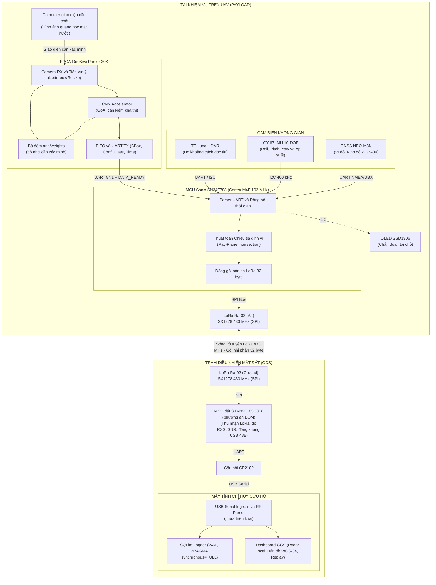

# TÀI LIỆU THIẾT KẾ HỆ THỐNG CHI TIẾT
## CUỘC THI THIẾT KẾ FPGA VÀ MCU MỞ RỘNG KHU VỰC MIỀN TRUNG 2026

*Dự án:* **Hệ thống tích hợp cho UAV hỗ trợ phát hiện, theo dõi và định vị người bị cuốn trôi trong bão lũ sử dụng FPGA và MCU (KVC)** 
---

> Cập nhật nội dung: **14/10/2026**. Bo đã có: **OneKiwi Primer 20K V1.1** theo xác nhận của nhóm. Tài liệu mô tả **thiết kế mục tiêu**, không xác nhận các khối phần cứng đã chạy. Hiện trạng xem [báo cáo tiến độ](KVC_PROJECT_STATUS.md); công việc xem [phân công](planning/KVC_PHAN_CONG_5_NGUOI.md) và [checklist](planning/KVC_CONG_VIEC_CHI_TIET_5_NGUOI.md).
>
> Cách đọc: mục III là linh kiện/cấu hình cần xác minh; mục IV là nhiệm vụ và **giao thức dự thảo chưa duyệt**; mục VII là nghiệm thu; mục VIII là nguồn tham chiếu. Bản này không chứa lịch 21 ngày; ngày/gate trong kế hoạch cũ là tham chiếu lịch sử.

### I. THÔNG TIN CHUNG

* **Tên đề tài:** Thiết kế hệ thống tích hợp cho UAV hỗ trợ phát hiện, theo dõi và định vị người bị cuốn trôi trong bão lũ sử dụng FPGA và MCU.
* **Đơn vị dự thi:** Đội KVC — Trường Đại học Bách Khoa – Đại học Đà Nẵng.
* **Trưởng nhóm:** Nguyễn Tất Vững (SĐT: 0325393717 – Email: tatvung1234@gmail.com).
* **Thành viên nhóm:**
  1. Nguyễn Tất Vững
  2. Trương Trung Kiên
  3. Đàm Nguyễn Mạnh Cường
  4. Nguyễn Tá Duy Phong
  5. Đoàn Thanh Trường Thịnh

---

### II. TỔNG QUAN GIẢI PHÁP VÀ KIẾN TRÚC HỆ THỐNG

#### 1. Bối cảnh và mục tiêu cốt lõi
KVC hướng tới tình huống cứu nạn bão lũ khi kết nối Internet hoặc kênh truyền video không ổn định. Mục tiêu là xử lý ảnh tại tải UAV và gửi thông tin mục tiêu dung lượng nhỏ về trạm đất; khả năng hoạt động trong điều kiện thực tế phải được đo.

Kiến trúc mục tiêu sử dụng **xử lý tại biên**. Các khối dưới đây cần triển khai và kiểm thử:
- **Phát hiện tại chỗ trên UAV:** Camera quang học thu hình ảnh mặt nước → FPGA OneKiwi Primer 20K tiền xử lý và chạy mạng nơ-ron tích chập (CNN) tăng tốc phần cứng để phát hiện người trôi dạt (`person`) và phao cứu sinh (`lifebuoy`).
- **Định vị không gian:** MCU Sonix SN34F788 nhận kết quả Bounding Box từ FPGA qua UART, đọc đồng bộ các cảm biến đo đạc (TF-Luna LiDAR, GY-87 IMU 10-DOF, GNSS NEO-M8N) và giải bài toán giao điểm tia quang học với mặt phẳng nước để xác định tọa độ thực tế.
- **Truyền tin vô tuyến tầm xa:** Thay vì truyền video, hệ thống chỉ đóng gói các thông tin cứu nạn quan trọng thành các gói tin nhị phân siêu nhỏ (**32 byte/gói**) và truyền metadata qua **LoRa 433 MHz**. RF 32 byte là dự thảo; cự ly, tỷ lệ nhận và độ trễ chưa được xác nhận bằng phép đo.
- **Trạm giám sát mặt đất (GCS):** MCU trạm đất giải mã gói tin LoRa, đóng khung USB 48 byte chuyển lên máy tính để Dashboard hiển thị mục tiêu tức thời trên giao diện Radar tọa độ local hoặc Bản đồ số (WGS-84).

#### 2. Ranh giới kỹ thuật và phạm vi nghiệm thu PoC
- **Bản chất hệ thống:** KVC là **tải nhiệm vụ (payload)** gắn trên UAV, độc lập với bộ điều khiển bay an toàn (flight controller). MCU không can thiệp điều khiển cân bằng bay hay cánh lái.
- **Phạm vi ưu tiên trong PoC:** Nhận diện người/phao trên video lũ lụt có sẵn; thử nghiệm và quay video tổng quan tại bể bơi để chứng minh luồng hệ thống–Dashboard; test trực tiếp thiết bị tại cuộc thi không dùng sa bàn. Khi đo định vị ở bể bơi, ưu tiên 1 mục tiêu, camera có pose và hệ local đã hiệu chuẩn (cm). WGS-84 ngoài trời là phép kiểm riêng khi có GNSS 3D fix; tại gian thi thiếu điều kiện định vị phải hiển thị INVALID/N/A.
- **Phân định 3 chế độ nguồn dữ liệu ở mức thiết kế:**
  - `REAL`: Dữ liệu thu nhận và suy luận thực tế từ phần cứng trên UAV.
  - `MOCK`: Dữ liệu giả lập. Source hiện có sinh MOCK trong trình duyệt hoặc backend PC; MOCK từ FPGA/MCU là bước tích hợp dự kiến.
  - `REPLAY`: Dữ liệu phát lại từ log SQLite trên máy tính phục vụ phân tích sau chuyến bay.
- **Ngoài phạm vi PoC:** Chế tạo khung bay UAV, chứng nhận hàng không DO-254/DO-178C, chứng nhận chống nước IP67.

#### 3. Hình thức trình diễn tại cuộc thi: hai video và một phần test trực tiếp

Nhóm trình bày **ba hoạt động theo thứ tự**: (1) video lũ lụt có sẵn kèm kết quả nhận diện AI; (2) video tổng quan thử nghiệm tại bể bơi và kết nối Dashboard; (3) vận hành/test hệ thống ngay tại địa điểm thi, **không dùng sa bàn**. Video bể bơi được quay trước cuộc thi; không yêu cầu mang bể bơi, bể nước hoặc bố trí các mốc sa bàn tại nơi thi.

| Hoạt động | Mục đích trước giám khảo | Đầu vào và nội dung trình bày | Bằng chứng cần chuẩn bị |
| :--- | :--- | :--- | :--- |
| **1. Video lũ lụt có sẵn — nhận diện AI** | Cho thấy AI phát hiện đối tượng trong bối cảnh lũ lụt | Video nguồn đã có; hiển thị khung nhận diện, tên lớp và confidence của person/lifebuoy khi xuất hiện. Có đoạn không mục tiêu để quan sát báo động giả. Có thể chạy inference trên file hoặc chiếu bản kết quả đã ghi, phải giới thiệu đúng cách thực hiện. | Video gốc/nguồn sử dụng, file kết quả, model/config/hash và log chạy; ghi PC_REFERENCE nếu suy luận trên laptop. Video chọn để trình diễn không thay đánh giá locked-test. |
| **2. Video bể bơi — tổng quan hệ thống và Dashboard** | Cho thấy cách lắp đặt và luồng dữ liệu từ quan sát tới màn hình giám sát | Quay toàn cảnh bể bơi, vị trí camera/tải, phần cứng thực dùng, trạm thu và laptop; xen màn hình nhận diện, trạng thái link/cảm biến, thông tin mục tiêu và log/replay trên Dashboard. | Video toàn cảnh + screen recording + session/capture cùng phiên; sơ đồ chỉ rõ phần đã chạy thật, phần MOCK hoặc PC_REFERENCE. Tọa độ chỉ trình bày khi có calibration và dữ liệu hợp lệ. |
| **3. Test trực tiếp tại cuộc thi — không sa bàn** | Chứng minh hệ thống đang vận hành và có thể thao tác trước giám khảo | Khởi động bộ thiết bị mang tới, kết nối Dashboard, đưa đầu vào thử, quan sát cập nhật/cảnh báo, kiểm ngắt–khôi phục link và lưu/phát lại phiên. Cấu hình đầu vào cụ thể được chốt khi tổng duyệt. | Checklist live, cấu hình/candidate cố định, log phiên mới tại cuộc thi và kết quả từng bước. Nếu dùng MOCK hoặc log cũ dự phòng phải ghi đúng nhãn, không ghi đã kiểm chuỗi REAL. |

##### 3.1. Video lũ lụt có sẵn

1. Chọn các đoạn nguồn hợp lệ, có đối tượng và điều kiện quan sát phù hợp; lưu nguồn/license hoặc quyền sử dụng, hash và đoạn thời gian đã chọn.
2. Chạy model candidate trên video, giữ đúng preprocessing/class mapping; trình bày hình gốc cùng overlay hoặc đối chiếu cạnh nhau. Nêu rõ thiết bị thực hiện inference.
3. Giới thiệu các lớp nhận diện, trường hợp đúng/bỏ sót/nhầm đáng chú ý; chỉ công bố số đo từ báo cáo evaluation có input và log tương ứng. Không suy vị trí địa lý hay khoảng cách người trong video khi thiếu thông tin camera/cảm biến của video gốc.
4. Chuẩn bị file nguồn và file kết quả offline. Nếu chạy inference ngay trên file tại cuộc thi, nêu rõ **đầu vào là video đã ghi, inference đang chạy**; nếu chiếu kết quả đã dựng, nêu rõ **kết quả đã ghi trước**.

##### 3.2. Video tổng quan tại bể bơi

1. Quay cảnh bố trí thử nghiệm và giải thích camera → nơi suy luận thực tế → MCU → LoRa → MCU đất → USB → Dashboard theo cấu hình đã hoàn thiện. Mỗi đoạn chỉ thể hiện thành phần thực sự có trong lần thử.
2. Quay mục tiêu trong bể bơi và màn hình Dashboard cùng phiên, có mốc thời gian/sự kiện chung để đối chiếu. Chỉ số link, trạng thái cảm biến, lớp/confidence và tọa độ được giải thích theo dữ liệu thật của phiên.
3. Thể hiện lúc có/không có mục tiêu, thay đổi quan sát, mất dữ liệu hoặc mất link và khôi phục nếu đã kiểm; kết thúc bằng mở log/replay của đúng phiên thử.
4. **LoRa chỉ truyền metadata, không truyền video.** Hình video/camera trên laptop phải có mô tả kênh riêng (file cục bộ, camera kết nối riêng hoặc screen recording theo cấu hình thực tế); không vẽ luồng video đi qua LoRa.
5. Nếu cần chứng minh định vị, đo/hiệu chuẩn hệ local của khu vực bể bơi trước khi ghi hình, lưu origin/pose/ground truth và log. Không mang các mốc này tới nơi thi; thiếu điều kiện định vị thì để INVALID/N/A và chỉ trình bày nhận diện/truyền dữ liệu.

##### 3.3. Checklist test trực tiếp tại địa điểm thi

- **Chuẩn bị:** bộ phần cứng đã được kiểm, nguồn/cáp/anten theo cấu hình, laptop có ứng dụng và assets offline, hai video đã quay và bản sao log/cấu hình. Không cần sa bàn hoặc bể nước tại gian thi.
- **Bước 1 — Khởi động:** mở Dashboard, kết nối thiết bị trạm đất, kiểm session mới và trạng thái từng thành phần có thật. Kiểm hoạt động local khi không có Internet.
- **Bước 2 — Đầu vào thử:** phương án ưu tiên để tổng duyệt là camera đang chạy với người/phao trong không gian thử phù hợp tại gian thi; nếu không phù hợp với camera/cấu hình đã chọn, chốt phương án chạy video file làm đầu vào trước ngày thi. Phải thử được đường đưa đầu vào tới nơi inference thực tế, không mặc định laptop có thể nạp file thẳng vào FPGA.
- **Bước 3 — Quan sát chuỗi:** đối chiếu sự kiện đầu vào với nhận diện, dữ liệu truyền, trạng thái link và Dashboard. Nếu chỉ kiểm một đoạn (ví dụ USB→GCS hoặc FPGA mock→MCU→GCS), ghi rõ phạm vi và nhãn MOCK/PC_REFERENCE; không suy ra toàn chuỗi đã hoạt động.
- **Bước 4 — Phục hồi:** thực hiện thao tác ngắt/kết nối lại USB hoặc link đã được thử trong tổng duyệt; Dashboard báo mất link/stale rồi khôi phục đúng session/state, không tiếp tục hiển thị dữ liệu cũ như dữ liệu mới.
- **Bước 5 — Lưu và phát lại:** kết thúc phiên test, mở log/replay của phiên vừa tạo và chỉ rõ nhãn REPLAY. Nếu live thất bại, có thể mở log bể bơi làm dự phòng nhưng phải công bố đó là phiên đã ghi trước.
- **Tọa độ tại nơi thi:** không giả định có GNSS 3D fix, mặt phẳng nước hoặc pose/origin đã hiệu chuẩn. Khi thiếu điều kiện, hiển thị INVALID/N/A; nhận diện và kiểm link vẫn tiếp tục. BBox trên ảnh không tự chứng minh tọa độ cứu nạn ngoài thực địa.

Ba hoạt động này là kịch bản **PLANNED**. Việc đổi cách trình diễn không xác nhận hardware đã chạy và không tự thay baud, ABI, CRC, IRQ, pinout hoặc mô hình. Nhãn nguồn REAL/MOCK/REPLAY của telemetry và provenance inference được giữ độc lập với việc **chiếu một video**; chiếu file MP4 không tự trở thành chế độ REPLAY của log SQLite.

#### 4. Sơ đồ kiến trúc đề xuất

Đây là sơ đồ DESIGN. Camera, bộ nhớ ngoài, accelerator và đường UART/IRQ cần chốt theo đúng bo; serial ingress chưa có trong backend. LoRa chỉ mang metadata, video về laptop cần kênh riêng.

---

### III. CẤU HÌNH PHẦN CỨNG, NGOẠI VI VÀ DANH MỤC LINH KIỆN HỆ THỐNG

#### 1. Cấu hình dự án và phần còn phải chốt

| Thành phần | Cấu hình làm việc | Trạng thái / việc cần xác minh |
| --- | --- | --- |
| FPGA | **OneKiwi Primer 20K V1.1**, Gowin GW2A-LV18PG256, nạp bằng GWU2X trên bo | Nhóm xác nhận đang có; không mua Tang Primer Dock thay thế. Chưa có project KVC/constraints hoặc log chạy trên bo. [S1] |
| MCU tải | **Sonix STK SN34F788**, Cortex-M4F tối đa 192 MHz, SRAM 160 KB, Flash 512 KB gồm vùng Boot 8 KB | Có hồ sơ/SDK; chưa xác nhận firmware KVC build/chạy. VDD chip 2,4–3,6 V; đầu vào 5 V của kit chỉ dùng đúng đường nguồn qua ổn áp theo schematic. Không nhầm SN32F788. [S3] |
| MCU đất | **STM32F103C8T6 Blue Pill + CP2102**, theo BOM nhóm đề xuất | C8 có Flash 64 KB, SRAM 20 KB, CPU tối đa 72 MHz. Chưa có firmware trạm đất KVC. Không tự đổi sang F401/F411/RP2040. [S16] |
| Camera | Chưa chốt module và cáp phù hợp OneKiwi | OV2640/OV5640 DVP là ứng viên; không mặc định bo có FPC DVP 24 chân tương thích. HDMI cũng cần RX/IP/nguồn ảnh đã thử, không chỉ có đầu cắm. |
| Bộ nhớ FPGA | Cần xác minh chip lắp thực tế, dung lượng và controller | Chưa chốt DDR3 128/512 MB, bus hay triple buffering. Manual/schematic public và bo V1.1 phải đối chiếu; không coi sơ đồ khối là bằng chứng DDR3 đã dùng được. |
| AI trên FPGA | Mục tiêu phát hiện person/lifebuoy | GoAI, model và INT8 còn cần kiểm khả thi. Model/adapter chạy PC không chứng minh đã chạy trên FPGA. |

Chi tiết nguồn và câu hỏi phần cứng: [OneKiwi](hardware/CHIP_ONEKIWI_20K_GOWIN_GW2A.md), [Sonix](hardware/CHIP_SONIX_SN34F788_MCU.md). Thông số chip không thay thế sơ đồ chân và cấu hình nguồn của module bán thực tế.

#### 2. Checklist linh kiện theo danh sách 29 mục của nhóm

Số lượng là **nhu cầu dự kiến**, không phải kiểm kê đã mua. Chỉ OneKiwi được nhóm xác nhận đang có. Kiên kiểm tồn kho/cáp/nguồn; Cường kiểm cảm biến/LoRa; Vững chốt camera; Thịnh xác minh bo đất; Phong tổng hợp cấu hình.

**Cách đọc In/Out:** mô tả luồng điện, dữ liệu hoặc cơ khí theo thiết kế KVC; chưa phải pinout đã duyệt hay bằng chứng module đã chạy. Các bus UART/I2C/SPI có cả lệnh và phản hồi tùy cấu hình. Với vật tư thụ động, In/Out chỉ mô tả chức năng điện/cơ, không phải cổng xử lý dữ liệu.

| STT | Linh kiện / vật tư | Nhu cầu | Chức năng trong KVC | In — Đầu vào | Out — Đầu ra | Yêu cầu cho dự án |
| --- | --- | --- | --- | --- | --- | --- |
| 1 | OneKiwi Primer 20K V1.1 | 1 bo, **mua thêm 0** | Thu nhận/xử lý ảnh và tạo kết quả nhận diện theo thiết kế. | Nguồn bo; bitstream qua USB-JTAG; luồng ảnh qua giao diện sẽ chốt. | BBox/lớp/confidence/thời gian qua UART và DATA_READY theo dự thảo; chưa xác nhận chạy trên bo. | Dùng bo đang có và GWU2X tích hợp; không áp dụng pinout/cáp Tang Dock. |
| 2 | Sonix STK SN34F788 | 1 bo | Nhận BBox, đọc cảm biến, tính vị trí khi hợp lệ và gửi metadata. | Nguồn kit đúng cổng; UART từ FPGA/TF-Luna/GNSS; dữ liệu IMU qua I2C. | SPI điều khiển Ra-02; dữ liệu mục tiêu/cảm biến xuống đất; I2C tới OLED nếu dùng. | Kiểm đúng mã chip, revision kit, cổng nguồn và debugger đi kèm. [S3] |
| 3 | Camera + cáp/adapter | 1 bộ, **chờ chốt** | Biến hình ảnh quang học thành luồng ảnh số cho FPGA. | Ánh sáng; nguồn đúng module; clock/lệnh cấu hình nếu module cần. | Luồng pixel DVP hoặc tín hiệu video qua giao diện được xác minh; không có sẵn BBox AI. | Chỉ mua sau kiểm tương thích với OneKiwi. Không mặc định DVP 24 chân, HDMI hay USB webcam cắm là chạy. |
| 4 | Benewake TF-Luna + cáp đúng đầu nối | 1 bộ | Đo cự ly dọc tia để hỗ trợ xác định mặt phẳng/độ cao khi phép đo hợp lệ. | Nguồn 5 V trong dải cho phép; ánh sáng phản xạ; lệnh cấu hình UART/I2C. | Cự ly, cường độ phản xạ amp và trạng thái/dữ liệu khác theo chế độ đã chọn qua UART/I2C. | Nguồn 3,7–5,2 V, logic 3,3 V. Dải 0,2–8 m với vật phản xạ 90%; 0,2–2,5 m với phản xạ 10%. Phải thử riêng mặt nước, amp và góc nghiêng; không coi 8 m là độ cao bay đã đạt. [S6] |
| 5 | GY-87 | 1 module | Đo chuyển động/từ trường/áp suất để firmware ước lượng tư thế. | Nguồn theo module; chuyển động, từ trường, áp suất; lệnh đọc/cấu hình I2C. | Dữ liệu thô accel/gyro và từ kế/khí áp nếu module thực có; không tự xuất pose camera đã hiệu chuẩn. | Kiểm chip/marking/schematic thực nhận; không mặc định mọi module đều MPU6050 + HMC5883L + BMP180. Đọc dữ liệu thô, hiệu chuẩn và tính attitude bằng firmware. |
| 6 | GNSS NEO-M8N hoặc ATGM336H đúng biến thể | 1 bộ | Cung cấp vị trí và thời gian GNSS ngoài trời. | Nguồn đúng module; tín hiệu vệ tinh từ anten; lệnh cấu hình UART nếu dùng. | Bản tin vị trí/thời gian/chất lượng fix qua UART theo protocol của module; UBX chỉ khi thiết bị hỗ trợ. | Chọn một mã/anten cụ thể. NEO-M8N GPS+GLONASS có cấu hình tối đa 5 Hz; không mặc định giá trị xuất xưởng. Anten active/passive theo module và mạch cấp anten, không bắt buộc active cho mọi loại. [S8] |
| 7 | Ra-02 SX1278 trên tải | 1 module | Phát metadata tải xuống trạm đất, có khả năng thu khi được cấu hình. | Nguồn 3,3 V; gói/lệnh SPI, reset từ MCU; anten RF phù hợp. | Sóng RF qua anten; DIO báo sự kiện; thanh ghi trạng thái qua SPI. | SPI, logic/nguồn 3,3 V; dùng cùng cấu hình RF với trạm đất. Module trần dạng castellated cần bo chuyển/hàn phù hợp. [S4] |
| 8 | Anten LoRa 433 MHz trên tải | 1 bộ | Ghép tín hiệu RF của Ra-02 với không gian vô tuyến. | RF từ module khi phát, hoặc sóng tới khi thu. | Sóng bức xạ khi phát, hoặc RF về module khi thu; linh kiện thụ động, không tạo dữ liệu số. | Đúng tần số và đầu nối, kèm cáp U.FL/IPEX–SMA nếu cần; gắn anten trước phát. |
| 9 | OLED SSD1306 I2C | 0 hoặc 1 | Hiển thị trạng thái chẩn đoán trên tải. | Nguồn đúng module; lệnh và bộ đệm hiển thị qua I2C từ Sonix. | Hình/chữ trạng thái trên màn hình; không gửi telemetry cứu nạn. | Tùy chọn chẩn đoán; kiểm mức nguồn/pull-up của module. |
| 10 | STM32F103C8T6 Blue Pill | 1 bo | Điều khiển LoRa đất và chuyển dữ liệu nhận tới máy tính. | Nguồn bo; dữ liệu/trạng thái SPI và DIO từ Ra-02 đất; SWD để nạp/debug. | UART tới CP2102, kèm gói và metadata link theo firmware/ABI được duyệt. | 64 KB Flash / 20 KB SRAM; mua dự phòng nếu cần. Nạp qua SWD. [S16] |
| 11 | CP2102 USB–UART | 1 module | Cầu nối UART MCU đất với cổng USB máy tính. | USB từ PC; TX/RX UART mức logic phù hợp từ MCU đất. | Cổng COM/luồng USB tới PC và UART về MCU; không tự giải mã nội dung gói RF. | Kiểm logic TX/RX 3,3 V; TX/RX/GND đủ cho UART cơ bản. Không dùng ngõ 3,3 V của CP2102 cấp cả MCU + LoRa; regulator chip tối đa 100 mA. [S5] |
| 12 | Ra-02 SX1278 trạm đất | 1 module | Thu metadata LoRa từ tải và cung cấp chất lượng link. | Nguồn 3,3 V; sóng RF từ anten; lệnh SPI/reset từ MCU đất. | Gói nhận và thanh ghi RSSI/SNR qua SPI; DIO báo sự kiện nhận theo cấu hình. | Như mục 7; tổng cộng 2 Ra-02, cần 2 bo chuyển nếu mua module trần. |
| 13 | Anten LoRa 433 MHz trạm đất | 1 bộ | Thu/phát RF ở trạm đất; đặt anten ở vị trí phù hợp. | Sóng tới từ tải hoặc RF từ module đất khi phát. | RF tới module đất khi thu hoặc sóng bức xạ khi phát; không có UART/SPI. | Đầu nối tương thích; cáp/đế đặt anten chắc chắn. Độ lợi quảng cáo không thay đo PRR/cự ly. |
| 14 | ST-Link V2 | 1 | Nạp firmware và debug STM32 qua SWD. | USB/lệnh từ PC; điện áp tham chiếu và phản hồi từ target. | Tín hiệu SWD tới STM32; dữ liệu debug/trạng thái về PC. | Cho STM32; kiểm đúng pin SWD/điện áp tham chiếu. |
| 15 | SN-LINK phù hợp kit Sonix | 1 bộ khả dụng | Nạp firmware và debug Sonix qua giao diện được kit hỗ trợ. | USB/lệnh từ PC; điện áp tham chiếu và phản hồi từ kit Sonix. | Tín hiệu nạp/debug tới Sonix; kết quả debug/nạp về PC. | Kiểm kit thực nhận có SN-LINK Lite tích hợp hay debugger rời; mua SN-LINK-V3 nếu thiếu/không tương thích. Có chân SWD không tự có debugger. [S3] |
| 16 | Cáp USB Type-C truyền dữ liệu | 2–3 dự kiến | Nối dữ liệu/cấp nguồn USB cho bo hoặc module đúng đầu cắm. | Nguồn và tín hiệu USB từ thiết bị ở một đầu. | Nguồn và tín hiệu tại đầu còn lại; cáp thụ động, cần loại có dây dữ liệu. | Đối chiếu đầu cắm OneKiwi và từng module; không mua chỉ theo số lượng. |
| 17 | Cáp Micro-USB truyền dữ liệu | 1–2 dự kiến | Nối USB cho kit/module có đầu Micro-USB. | Nguồn và tín hiệu USB từ PC/nguồn đúng chuẩn. | Nguồn và dữ liệu sang bo nếu bo có USB firmware/bridge phù hợp; không chuyển USB thành SWD. | Theo bo thực nhận. Micro-USB trên Blue Pill không thay ST-Link nếu chưa có bootloader/firmware USB phù hợp. |
| 18 | Buck DC–DC | 2–3 dự kiến | Hạ áp nguồn đầu vào thành các rail DC phù hợp. | DC từ nguồn bàn/pin trong dải Vin của mạch. | DC 5 V hoặc 3,3 V theo mạch đã chỉnh/kiểm; camera theo yêu cầu riêng. | MP1584/MP2307/LM2596 là ứng viên; chọn theo Vin, dropout, dòng liên tục và nhiệt thực đo. Rail 5 V cho đầu vào bo/TF-Luna; rail 3,3 V cho phần phù hợp. Camera theo module. Không cấp 3,3 V thẳng vào lõi FPGA. |
| 19 | Nguồn bàn để thử; pin LiPo 2S–3S nếu thử di động | Theo cấu hình thử | Cấp điện cho buổi thử trên bàn hoặc tải di động. | Nguồn bàn: điện lưới/adapter phù hợp; LiPo: sạc cân bằng đúng loại khi nạp. | DC cấp cho buck/khối nguồn; không tạo dữ liệu số. | Nguồn bàn có giới hạn dòng; pin có đầu nối và bộ sạc cân bằng đúng loại. Tính ngân sách dòng và thời lượng sau đo tải thực. |
| 20 | Tụ hóa 100–220 µF | 5–10 | Đệm năng lượng và giảm sụt áp tại rail nguồn. | Điện áp trên VCC/GND, kể cả biến động khi tải đổi. | Cấp/thu dòng tức thời trên cùng rail; hai chân thụ động, không có tín hiệu ra riêng. | Chọn điện áp định mức theo rail; đặt sát Ra-02, kiểm cực tính/ESR và đo sụt áp khi phát. |
| 21 | Tụ gốm 100 nF | 5–10 | Lọc nhiễu cao tần gần chân nguồn. | Thành phần nhiễu trên rail VCC/GND. | Đường dẫn nhiễu cao tần về GND khi mắc đúng; không có dữ liệu hay cổng ra riêng. | Decoupling gần chân nguồn, phối hợp tụ khối. |
| 22 | Trở 4,7 kΩ / 10 kΩ | 5–10 | Kéo SDA/SCL về mức logic cao phù hợp khi bus nhả. | Điện áp rail logic và trạng thái đường bus I2C. | Mức kéo lên trên cùng đường SDA/SCL; không tạo xung clock/gói dữ liệu. | Dự phòng pull-up I2C; kiểm trở sẵn trên module, tổng tải và rise time trước chọn giá trị/tốc độ. Pull-up về mức logic phù hợp. |
| 23 | Dupont cái–cái | 1 tép | Nối chân module có header đực để thử trên bàn. | Điện/tín hiệu tại đầu dây thứ nhất. | Cùng điện/tín hiệu ở đầu dây thứ hai; không đổi mức điện. | Thử trên bàn; đường clock/video cần cáp phù hợp, không mặc định dây Dupont bảo đảm timing. |
| 24 | Dupont đực–cái | 1 tép | Nối module/header với breadboard hoặc chân phù hợp. | Điện/tín hiệu tại đầu đực hoặc cái. | Cùng điện/tín hiệu tại đầu còn lại; không chuyển đổi giao thức. | Thử module/breadboard. |
| 25 | Breadboard | 1–2 | Tạo điểm nối tạm để thử cảm biến/mạch phụ. | Chân linh kiện/dây được cắm vào các dải tiếp điểm. | Các điểm cùng dải được nối điện; không có xử lý hay nguồn tự tạo. | Test nguồn thấp/cảm biến; không dùng làm gá chịu rung cho tải bay. |
| 26 | Protoboard | 2–3 | Làm nền hàn cố định mạch phụ và dây nguồn/tín hiệu. | Linh kiện, mối hàn và dây theo sơ đồ. | Mạng nối điện sau hàn; không tự xử lý dữ liệu. | Hàn cố định mạch phụ/nguồn, kiểm chập và chống kéo dây. |
| 27 | Header 2,54 mm | 2–3 thanh | Tạo đầu cắm tháo lắp cho module/bo. | Nguồn/tín hiệu và lực tiếp xúc ở một phía. | Nối điện sang phía còn lại; không đổi mức/giao thức. | Đối chiếu chân thực trên module; thêm breakout Ra-02 nếu cần. |
| 28 | Trụ/ốc M2, M3 | 1 bộ | Giữ bo đúng vị trí, tạo khoảng cách và liên kết cơ khí. | Bo mạch, vị trí lỗ và lực siết lắp. | Bộ gá cơ khí cố định; không có I/O dữ liệu. | Theo lỗ bo, có cách điện và chống lỏng. |
| 29 | Gá in 3D camera–LiDAR–IMU | 1 bộ | Giữ camera–LiDAR–IMU có tư thế tương đối ổn định. | Kích thước/vị trí bo, hướng trục và yêu cầu lắp. | Cụm gá cố định với geometry có thể đo/hiệu chuẩn; không tự tạo pose/tọa độ. | Giữ tư thế tương đối cố định, đo extrinsics và hướng trục. Căn gần cùng hướng không thay hiệu chuẩn, không yêu cầu IMU có trục quang học đồng trục camera. |

**Vật tư đo/lắp cần có thêm hoặc mượn:** đồng hồ vạn năng, logic analyzer cho UART/I2C/SPI; oscilloscope khi kiểm nguồn/timing; dây nguồn đúng dòng, đầu nối khóa, công tắc/cầu chì; sạc cân bằng và theo dõi điện áp nếu dùng LiPo. Không thêm camera nhiệt/gimbal vào BOM hiện tại.

**Trước cấp nguồn:** Kiên lập sơ đồ nguồn theo module thật, Phong/Cường kiểm VDD/VDDIO của MCU và cảm biến, Vững kiểm VCCIO của FPGA. Dòng phát/điện áp ra của module nguồn phải đo trong cấu hình thử; không chốt mức 120–130 mA hay 2–3 A chỉ từ mô tả chung.

---

### IV. PHẦN MỀM, RTL VÀ GIAO THỨC TRUYỀN THÔNG

#### 1. Phân chia nhiệm vụ xử lý giữa các phân hệ

**Hiện có trong workspace:** frontend React/TypeScript, backend FastAPI MOCK, SQLite logger/replay và AI tham chiếu PC. Chưa thấy project RTL/firmware KVC dạng rời hoặc serial ingress. Bảng sau là nhiệm vụ cần hoàn thiện; SDK mẫu không tính là KVC đã chạy.

**Trạng thái giao thức:** toàn bộ mục IV.2–IV.4 là **DRAFT / CHƯA DUYỆT**. Giữ nguyên baud, layout, CRC và IRQ của dự thảo trong lượt cập nhật tài liệu này; không triển khai hoặc đổi giao thức phần cứng chỉ để khớp tài liệu. Telemetry 20 byte là ghi nhận source lịch sử, chưa thấy parser đó trong backend hiện tại.

**Điểm phải giải quyết trước khi khóa ABI:** Width/Height 1 byte chưa rõ cách biểu diễn kích thước ảnh lớn hơn 255; quy tắc wrap sequence/session/time; timestamp và đồng bộ clock; CRC/timeout/resync cho UART; cách nhả/ack DATA_READY và chống mất frame. Cờ LIDAR_VALID phải dựa cả chất lượng phép đo và timeout, không chỉ kiểm khoảng 20–800 cm. Các bảng byte phía dưới được giữ để thảo luận, chưa giải quyết các điểm mở này.

| Phân hệ | Nhiệm vụ bắt buộc (Bắt buộc hoàn thành) | Nhiệm vụ mở rộng (Làm khi còn thời gian) |
| :--- | :--- | :--- |
| **FPGA** | Camera RX, bộ đệm theo bộ nhớ đã xác minh, tiền xử lý ảnh (Resize/Letterbox), accelerator AI sau kiểm khả thi, bộ đệm FIFO và UART TX đóng gói ứng viên BBox; có chế độ BBox giả (Mock) phục vụ kiểm thử. | Tối ưu xung nhịp FPS, chuyển toàn bộ thuật toán NMS sang RTL, thiết kế pipeline song song kép. |
| **MCU Tải (Sonix)**| Bộ giải mã UART từ FPGA, thu thập cảm biến có timestamp (LiDAR, IMU, GNSS), thuật toán chiếu tia định vị mục tiêu, theo dõi (tracking) 1 mục tiêu ở mức thiết kế, đóng gói và điều khiển phát LoRa 32 byte, watchdog an toàn. | Lọc Kalman nâng cao, theo dõi đa mục tiêu đồng thời, lưu trữ flash bền vững khi mất sóng dài ngày. |
| **MCU Trạm đất** | Driver SPI điều khiển Ra-02 ở chế độ nhận liên tục, kiểm tra CRC phần cứng, đọc RSSI và SNR, đóng khung USB 48 byte chuyển tiếp lên máy tính. | Bổ sung cơ chế phát gói ACK phản hồi khi đường truyền rảnh. |
| **Dashboard GCS** | Ingress Serial Framer, kiểm tra session và bộ giải mã RF v1, bộ quản lý trạng thái (Reducer), giao diện Radar local và Bản đồ WGS-84, SQLite logger (WAL), Replay phiên. | Hiển thị lớp bản đồ vệ tinh ngoại tuyến (Tile map), thống kê nâng cao. |

Ghi chú về thuật ngữ: “sa bàn” trong các mô tả field local/origin ở dự thảo wire dưới đây là tên gọi lịch sử của hệ tọa độ local đã hiệu chuẩn, không phải yêu cầu có mô hình sa bàn tại nơi thi. Có thể áp dụng tại khu vực bể bơi khi origin/pose/đơn vị được xác lập; giữ nguyên các field, bits và layout dự thảo, C+D vẫn phải chốt ABI.

#### 2. Giao tiếp nội bộ FPGA ↔ MCU Sonix
- **Đặc tả vật lý:** UART 8N1 (8 bit dữ liệu, không parity, 1 stop bit), mức điện áp logic 3,3V CMOS. Tốc độ khởi đầu 115.200 bps, kiểm tra sai số nâng lên 460.800 bps hoặc 921.600 bps. Nối chung GND chặt chẽ.
- **Cấu trúc khung truyền kết quả AI:**
  `[Sync: 0x5A 0xA5 (2B)]` + `[Version: 1B]` + `[Candidate Count: 1B (tối đa 20)]` + `[Timestamp: 4B]` + `[Danh sách BBox: N × 8B]` + `[CRC-16: 2B]`.
  Mỗi BBox 8 byte gồm: `X_center (2B)` + `Y_center (2B)` + `Width (1B)` + `Height (1B)` + `Class_ID (1B: 1=person, 2=lifebuoy)` + `Confidence (1B: 0–100)`.
- **Cơ chế ngắt và Flow Control:** Chân `DATA_READY` từ FPGA chuyển lên mức cao để kích hoạt ngắt ngoài (EXTI) trên MCU Sonix khi có frame mới. Ngắt ISR trên MCU chỉ làm nhiệm vụ kích hoạt DMA hoặc nhận byte vào ring buffer, không tính toán định vị hay gọi hàm trễ trong ngắt.

#### 3. Đặc tả giao thức vô tuyến LoRa v1 (RF Payload 32 byte cố định)
- **Quy tắc chung:** Toàn bộ số nguyên nhiều byte lưu thứ tự **Little-Endian**. Số nguyên có dấu dùng dạng bù hai. Chiều dài gói RF cố định đúng **32 byte**. Thuật toán kiểm tra lỗi là **CRC-16/CCITT-FALSE** (Poly `0x1021`, Init `0xFFFF`, RefIn/RefOut `false`, XorOut `0x0000`) tính toán trên 30 byte đầu (offset 0–29), lưu low-byte trước tại offset 30–31.

##### a. Bảng gói tin Type=0x01 (Telemetry tải) và Type=0x02 (Target mục tiêu)

| Offset | Kích thước | Tên trường | Kiểu dữ liệu | Ý nghĩa bắt buộc |
| :---: | :---: | :--- | :--- | :--- |
| **0–1** | 2 byte | Sync Header | `uint8[2]` | Luôn là `0xAA 0x55` (Byte đồng bộ bắt đầu gói) |
| **2** | 1 byte | Version | `uint8` | Phiên bản giao thức (giá trị `1`) |
| **3** | 1 byte | Packet Type | `uint8` | `0x01`: Telemetry tải; `0x02`: Target mục tiêu; `0x03`: Status hệ thống |
| **4–5** | 2 byte | Sequence Number | `uint16` | Số thứ tự gói tin tăng đơn điệu trong phiên (0..65535, không dùng lại) |
| **6–7** | 2 byte | Track ID | `uint16` | Telemetry = `0`; Target = `1..65535` (Định danh chuỗi bám mục tiêu) |
| **8–11** | 4 byte | Measurement Time | `uint32` | Thời điểm quan sát (ms tính từ lúc boot MCU tải) |
| **12–15** | 4 byte | Coordinate A | `int32` | Nếu Bit8=0: Vĩ độ (Latitude độ × 10⁷); Nếu Bit8=1: Tọa độ X sa bàn (cm) |
| **16–19** | 4 byte | Coordinate B | `int32` | Nếu Bit8=0: Kinh độ (Longitude độ × 10⁷); Nếu Bit8=1: Tọa độ Y sa bàn (cm) |
| **20–21** | 2 byte | LiDAR Range | `uint16` | Cự ly dọc tia laser (cm); giá trị `65535` nếu lỗi/ngoài dải |
| **22** | 1 byte | Confidence | `uint8` | Target: Độ tin cậy AI (0–100%); Telemetry: gán mặc định `255` |
| **23** | 1 byte | Battery Level | `uint8` | Dung lượng pin (0–100%); `255` nếu chưa xác định |
| **24–25** | 2 byte | System Flags | `uint16` | Cờ trạng thái 16-bit (chi tiết bảng bit bên dưới) |
| **26–29** | 4 byte | Sender Session ID | `uint32` | Mã định danh phiên làm việc của tải (tăng đơn điệu mỗi lần khởi động lại) |
| **30–31** | 2 byte | CRC-16 Checksum | `uint16` | CRC-16 tính trên bytes 0–29, lưu low-byte trước |

##### b. Chi tiết định dạng 16-bit trường System Flags
- **Bit 0 (`GPS_VALID`):** `1` = GNSS đạt 3D fix và dữ liệu còn hạn; `0` = Chưa có fix.
- **Bit 1 (`LIDAR_VALID`):** `1` = Cự ly LiDAR hợp lệ và nằm trong dải 0,2–8 m; `0` = Ngoài dải/lỗi.
- **Bit 2 (`IMU_VALID`):** `1` = Dữ liệu góc nghiêng IMU hợp lệ và đã qua hiệu chuẩn.
- **Bit 3 (`AI_DETECTED`):** `1` = Mục tiêu được phát hiện trực tiếp bởi mô hình AI.
- **Bits 4–5 (`SOURCE_MODE`):** `00`: REAL (phần cứng thật); `01`: MOCK (giả lập); `10`: REPLAY (phát lại log); `11`: Bị từ chối.
- **Bit 6 (`TARGET_CONFIRMED`):** `1` = Mục tiêu được AI phát hiện liên tiếp ≥ 3 khung hình.
- **Bit 7 (`POS_VALID`):** `1` = Tọa độ tính toán hợp lệ; `0` = Không đủ điều kiện định vị (Coordinate A và B ghi giá trị sentinel `INT32_MIN` = `-2147483648`).
- **Bit 8 (`LOCAL_FRAME_ACTIVE`):** **Cờ phân định hệ tọa độ:** `0` = Hệ WGS-84 toàn cầu (độ × 10⁷); `1` = Hệ Local sa bàn (cm).
- **Bits 9–11 (`CLASS_ID`):** Phân loại mục tiêu: `0` = Unknown; `1` = `person` (người); `2` = `lifebuoy` (phao cứu sinh); 3–7 = Dự phòng.
- **Bits 12–15:** Mặc định gán `0`.

##### c. Bảng gói tin Type=0x03 (Boot / Status chẩn đoán)
Gói Status dùng chung Sync (0–1), Version (2), Type `0x03` (3), Sequence (4–5), Session (26–29) và CRC (30–31). Thân gói tin (offset 6–25) phát định kỳ 5 giây/lần:
- `Boot count (Offset 6–7, uint16)`: Số lần khởi động lại của MCU.
- `Status time (Offset 8–11, uint32)`: Thời gian uptime của MCU (ms).
- `TxDone count (Offset 12–15, uint32)`: Tổng số gói đã phát thành công trong phiên.
- `TxFail count (Offset 16–19, uint32)`: Tổng số lần thử phát lỗi/timeout.
- `TX drops (Offset 20–21, uint16)`: Số gói bị bỏ do hàng đợi phát bị đầy.
- `Origin ID (Offset 22, uint8)`: Mã định danh gốc sa bàn (0: Không dùng; 1–255: Ánh xạ tới manifest sa bàn).
- `Battery (Offset 23, uint8)` & `Flags (Offset 24–25, uint16)`: Trạng thái nguồn và cờ `SOURCE_MODE`.

#### 4. Khung dữ liệu USB Ground Envelope (48 byte cố định)
MCU trạm đất sau khi thu nhận gói LoRa qua SPI sẽ bọc thêm thông tin chất lượng sóng (metadata) thành khung USB 48 byte chuyển lên máy tính qua cổng Serial:

| Offset | Kích thước | Tên trường | Kiểu dữ liệu | Ý nghĩa |
| :---: | :---: | :--- | :--- | :--- |
| **0–1** | 2 byte | USB Sync | `uint8[2]` | Luôn là `0xAA 0x7E` |
| **2** | 1 byte | Length | `uint8` | Cố định `43` (`0x2B`, số byte từ offset 3 đến 45) |
| **3–4** | 2 byte | Ground Session ID | `uint16` | Mã phiên làm việc của MCU trạm đất (tăng sau mỗi lần boot) |
| **5–8** | 4 byte | Ground RX Time | `uint32` | Thời điểm nhận gói tại MCU trạm đất (ms từ boot) |
| **9** | 1 byte | Packet RSSI | `int8` | Cường độ tín hiệu sóng thu được (dBm, từ -127 đến 0 dBm) |
| **10** | 1 byte | Packet SNR | `int8` | Tỷ số tín hiệu trên nhiễu (đơn vị bước 0,25 dB; ví dụ -8 = -2 dB) |
| **11** | 1 byte | RF CRC Status | `uint8` | `0`: Hardware CRC PASS; `1`: Hardware CRC FAIL |
| **12–13** | 2 byte | Ground RX Counter| `uint16` | Bộ đếm số gói LoRa đã thu nhận được tại trạm đất |
| **14–45** | 32 byte | Raw RF Payload | `uint8[32]` | **Giữ nguyên vẹn 32 byte dữ liệu gốc nhận từ LoRa** |
| **46–47** | 2 byte | Envelope CRC | `uint16` | CRC-16/CCITT-FALSE tính trên 46 byte đầu (offset 0–45) |

---

### V. ĐỊNH VỊ KHÔNG GIAN, THEO DÕI VÀ TRẠM MẶT ĐẤT (GCS)

#### 1. Mô hình chiếu tia định vị mục tiêu (Ray-Plane Intersection)
1. **Thiết lập hình học:** Chọn điểm ảnh đại diện mục tiêu và giao tia với mặt phẳng nước đã xác định. Dùng tâm Bounding Box là xấp xỉ cần đo sai số; tâm box người đứng/phao không mặc định nằm đúng trên mặt nước:

$$
\mathbf{p}_{\text{local}} = \mathbf{t}_{\text{camera}} + \lambda \cdot \mathbf{R}_{\text{camera}} \cdot \mathbf{v}_{\text{pixel}}
$$

Trong đó:
- $\mathbf{t}_{\text{camera}} = [X_c, Y_c, Z_c]^\top$: Tọa độ tâm camera trong hệ local của khu vực thử nghiệm bể bơi (đo đạc chính xác khi gá đặt).
- $\mathbf{R}_{\text{camera}}$: Ma trận xoay camera sang hệ local, kết hợp attitude do firmware ước lượng từ IMU đã hiệu chuẩn với phép quay extrinsic IMU–camera; không dùng trực tiếp dữ liệu thô GY-87 như góc Euler.
- $\mathbf{v}_{\text{pixel}}$: Vector hướng tia xuất phát từ tiêu cự camera xuyên qua điểm pixel tâm Bounding Box $(u, v)$ sau khi đã khử méo ống kính (undistortion).
- $\lambda$: Hệ số tỷ lệ độ dài tia, được xác định bằng cách giải phương trình giao điểm của tia với mặt phẳng nước $Z = 0$ (hoặc mặt phẳng độ cao xác định bởi LiDAR TF-Luna và góc nghiêng).
2. **Quy tắc tính toán và điều kiện hợp lệ:**
- Cần camera intrinsics/distortion, phép đổi tọa độ sau resize/letterbox, extrinsics camera–IMU–LiDAR–GNSS và mẫu cảm biến đồng bộ theo thời điểm ảnh. GNSS 3D fix một mình chưa đủ xác nhận tọa độ mục tiêu.
- TF-Luna chỉ đo dọc một tia; chỉ suy ra mặt phẳng nước khi biết hướng/điểm đặt cảm biến và xác nhận tia phản xạ từ đúng bề mặt. Kiểm amp, timeout, góc tới và phản xạ thực; IMU bù nghiêng không chữa được phép đo mặt nước sai.
- Hệ local không cần GNSS khi camera được gá cố định và pose đã đo. Nếu tải di chuyển, cần cập nhật vị trí camera theo hệ local; IMU đơn lẻ không cung cấp vị trí tịnh tiến ổn định.
- Chỉ tính tọa độ khi các điều kiện trên hợp lệ. Thiếu dữ liệu thì báo INVALID/N/A; không tự chuyển sang local hợp lệ chỉ vì mất GNSS.
- Hệ thống chỉ xuất tọa độ hợp lệ (`POS_VALID = 1`) khi mẫu số tính $\lambda$ không gần 0 (tia không song song với mặt nước) và $\lambda > 0$ (mục tiêu nằm phía trước camera).
- Nếu UAV bị nghiêng vượt ngưỡng hoặc LiDAR đo lỗi/ngoài dải → Gán `POS_VALID = 0`, tọa độ gán `INT32_MIN`.
3. **Phân biệt hai hệ quy chiếu tọa độ:**
- **Chế độ tọa độ cục bộ (Local frame - `LOCAL_FRAME_ACTIVE = 1`):** Đơn vị tính là **centimet (cm)** so với gốc O(0, 0) của khu vực thử nghiệm đã đo, ví dụ bể bơi. Chế độ này độc lập với GNSS nhưng cần origin và hiệu chuẩn camera/pose gắn với `Origin ID`. Tại nơi thi không có sa bàn và không có hiệu chuẩn local phù hợp thì để `POS_VALID = 0`, không tự gán tọa độ hợp lệ.
- **Chế độ Toàn cầu (WGS-84 frame - `LOCAL_FRAME_ACTIVE = 0`):** Đơn vị tính là **độ × 10⁷**. Chỉ kích hoạt khi GNSS NEO-M8N đạt `GPS_VALID = 1` (3D fix); kết hợp vị trí GNSS của UAV và vector khoảng cách để suy ra tọa độ Vĩ độ/Kinh độ của nạn nhân.

#### 2. Kiến trúc và cơ chế hoạt động của Dashboard GCS

| Nội dung | Source hiện có | Phần cần hoàn thiện |
| --- | --- | --- |
| Đầu vào | MOCK trong frontend hoặc backend; backend phát event MOCK/REPLAY | USB serial framer, parser RF/USB, dữ liệu REAL và reconnect thiết bị |
| UI | React/TypeScript/Vite, radar local, bản đồ Leaflet 2D, cảnh báo, điều khiển replay | Browser E2E, hành vi mất link/dữ liệu thật và máy demo |
| Hàng đợi | Backend mặc định tối đa 64 event/client, logger queue 1024; xem config.py | Framer 4 KB và FIFO ingress 256 envelope là dự thảo GCS, chưa phải queue đang chạy |
| SQLite | WAL/FULL, writer riêng, commit ticket và lưu event; raw fields có thể null khi MOCK | Capture thật và kiểm phục hồi đúng candidate; queue nhận event chưa có nghĩa đã commit |
| Replay | Đọc phiên đã commit, pause/seek/speed qua backend | Kiểm phiên dài và đồng thời nhiều thao tác; không mặc định có xuất/nhập JSONL |
| Offline | Assets ứng dụng đóng gói local; radar không cần tiles | Phải thử offline cold-cache; bản đồ nền không mặc định offline, cần nguồn tiles có quyền hoặc chấp nhận không có nền |

Luồng mục tiêu: USB → framer/decoder → state → logger/WebSocket → UI. Luồng này còn thiếu đoạn USB/parser; hiện tại MOCK PC vào state/logger/WebSocket. Video trên laptop là kênh riêng, không đi qua LoRa.

WAL/FULL giúp bảo vệ giao dịch đã commit theo khả năng hệ điều hành/thiết bị lưu trữ, không bảo đảm cứu mọi event còn trong RAM khi mất điện. Phép thử kill process không thay phép thử mất nguồn. Khi sao lưu phiên cần thực hiện đúng quy trình SQLite. [S14][S15]

Nguồn hiện hành: [backend README](../Dashboard/backend/README.md), [frontend README](../Dashboard/frontend/README.md), [data contract](gcs/KVC_GCS_DATA_CONTRACT.md). Contract phân biệt schema ứng dụng đã có với wire draft; không dùng bảng draft để suy ra endpoint REAL đã triển khai.

---

### VI. QUY CHUẨN DỮ LIỆU VÀ LƯỢNG TỬ HÓA AI (INT8)

#### 1. Bộ dữ liệu huấn luyện và giải quyết Domain Shift (Dataset Contract)
**Trạng thái:** workspace có dataset, weights và reports PC; chưa có evidence release đầy đủ hoặc phép đo INT8 trên FPGA. Mục tiêu 1.000 ảnh bên dưới là số ảnh có nguồn/QA cần đạt, không phải kiểm kê dataset hiện có. Xem [chuẩn bị dữ liệu AI](ai/KVC_AI_DATA_PREPARATION.md).

**Người phụ trách:** Cường thu video/ảnh thực tế theo phiên; Kiên và Vững hỗ trợ camera/pose; Thịnh làm nhãn, QA, split và đánh giá; Phong điều phối, cùng nhóm quyết định có cần train lại từ kết quả đánh giá. Video demo không tự là dữ liệu test độc lập.

Dữ liệu cần phản ánh hai bối cảnh trình diễn: video lũ lụt có sẵn và cảnh thử nghiệm bể bơi. Các nguồn mở như SeaDronesSee chỉ là nguồn tham khảo/bổ sung khi có quyền sử dụng và mapping nhãn phù hợp; phải đánh giá riêng chênh lệch góc nhìn, nền nước, ánh sáng và đối tượng giữa nguồn lũ lụt với bể bơi. Không mặc định kết quả tốt ở bể bơi chứng minh hiệu năng cứu nạn ngoài thực địa.
- **Quy mô tập dữ liệu PoC (mục tiêu cần kiểm chứng):** Tối thiểu **1.000 ảnh có nguồn và QA**, từ các phiên bể bơi và nguồn lũ lụt hợp lệ; lưu nhãn miền dữ liệu và số lượng từng nguồn. Video lũ lụt có sẵn dùng để demo không mặc định được phép dùng để train. Dự kiến chia thành:
  - **Tập Train:** 700 ảnh (bao gồm 200 ảnh pilot ban đầu).
  - **Tập Validation:** 150 ảnh (dùng tinh chỉnh ngưỡng và đánh giá suy giảm INT8).
  - **Tập Locked-Test:** 150 ảnh (đóng băng độc lập, chỉ dùng đánh giá nghiệm thu cuối cùng).
- **Phân chia theo phiên/nguồn độc lập (Session Split):** Mục tiêu tối thiểu 12 phiên hoặc nhóm video nguồn độc lập (8 train, 2 val, 2 test); thay đổi góc camera, ánh sáng, phản chiếu, khoảng cách và độ che khuất trong điều kiện thử nghiệm cho phép. Toàn bộ frame gần nhau/cùng video nguồn nằm trong cùng split; không chia ngẫu nhiên frame để tạo test độc lập giả. Báo cáo kết quả riêng miền lũ lụt và bể bơi khi có đủ mẫu, không yêu cầu tạo nước lũ mô phỏng tại bể bơi.
- **Tập mẫu âm tính (Hard-Negative Samples):** Mục tiêu **20–30%** tổng số ảnh đã QA, không có người/phao; gồm mặt nước trống, phản chiếu, bọt nước và vật nền xuất hiện tự nhiên trong video/bối cảnh thử. Đo báo động giả trên các đoạn này; tỷ lệ mẫu âm tính không tự đảm bảo loại bỏ false alarm.
- **Bảng phân loại (Ontology):**
  - Lớp 0 (`person`): Người nhìn thấy trong nguồn lũ lụt hoặc phiên thử bể bơi; nếu dùng mannequin/mô hình thì ghi rõ loại đối tượng và đánh giá riêng theo ontology hiện hành → Mapping dự thảo `CLASS_ID = 1`.
  - Lớp 1 (`lifebuoy`): Phao cứu sinh các loại → Ánh xạ sang mã truyền thông `CLASS_ID = 2`.

- **Tách video demo và evaluation:** Video trình chiếu chọn để giải thích hệ thống; nếu đã dùng train/tuning phải công bố, không coi đó là locked-test. Các đoạn test độc lập được khóa trước chọn candidate cuối, kèm hash nguồn/model/config; không suy Precision/Recall định lượng chỉ từ overlay đẹp.

#### 2. Mô hình YOLO11n, tiền xử lý và lượng tử hóa INT8 (GoAI)

- **Mô hình thống nhất:** Ultralytics **YOLO11n** (biến thể nano của YOLO11), tác vụ detection, hai lớp person/lifebuoy. Tên kiến trúc trong cấu hình là `yolo11n`; model nền là `yolo11n.pt`; checkpoint sau train có thể mang tên `best.pt` hoặc `last.pt` trong run tương ứng. [Tài liệu YOLO11 chính thức](https://docs.ultralytics.com/models/yolo11/).
- **Trạng thái:** đây là lựa chọn mô hình của dự án, không xác nhận mọi file best.pt đã là YOLO11n. Trước sử dụng phải đối chiếu kiến trúc, mapping lớp và hash của checkpoint. Đổi nhãn không chuyển kiến trúc weights; hỗ trợ GoAI/INT8 và kết quả trên FPGA vẫn cần xác minh.
- **Hợp đồng tiền xử lý cần khóa theo candidate:** cấu hình tham chiếu PC dùng RGB, letterbox 640×640, màu đệm 114 và chuẩn hóa float [0,1]. Target FPGA cần chốt một kích thước và cách chuyển pixel về ảnh gốc; tensor INT8 phải theo scale/zero-point của model chuyển đổi, không áp dụng float normalization một cách máy móc.
- **Tập định chuẩn (Calibration Corpus):** Trích xuất **100 ảnh thực tế** đại diện từ tập `Train` để tính toán dynamic range cho các lớp mạng khi lượng tử hóa Post-Training Quantization (INT8). Tuyệt đối không dùng ảnh tập Test để calibration.
- **Quy trình đối chiếu 4 bước nghiêm ngặt:**
  1. Đánh giá mô hình Float gốc trên máy tính.
  2. Đánh giá mô hình Float sau khi chuyển đổi graph (ONNX/TFLite).
  3. Đánh giá mô hình INT8 trên runtime mô phỏng (LiteRT/TensorFlow).
  4. Đánh giá mô hình INT8 chạy thực tế trên bo FPGA OneKiwi Primer 20K.
- **Chỉ tiêu kỹ thuật lượng tử hóa:**
  - Độ suy giảm Recall và Precision của mô hình INT8 trên FPGA so với mô hình Float gốc ≤ 3 điểm phần trăm.
  - Độ lệch tâm Bounding Box trung bình giữa Float và INT8 < 5 pixel.

---

### VII. TIÊU CHÍ ĐO KIỂM, NGHIỆM THU VÀ QUẢN TRỊ RỦI RO

#### 1. Bảng tiêu chí đo kiểm nghiệm thu kỹ thuật (Acceptance Criteria)

| Hạng mục kiểm tra | Phương pháp đo kiểm và Bằng chứng | Tiêu chí nghiệm thu (Mục tiêu thiết kế) |
| :--- | :--- | :--- |
| **Độ chính xác AI** | Locked-test độc lập ≥ 150 ảnh có nguồn/QA, bao phủ và báo riêng miền lũ lụt/bể bơi; khóa trước khi tiến hành nghiệm thu tổng thể. Đo false alarms trên đoạn video âm tính có thời lượng ghi rõ. | Mục tiêu **Recall ≥ 90%**, **Precision ≥ 90%** (IoU 0.5), báo động giả ≤ 1 lần/phút; video demo chọn sẵn không thay phép đo này. |
| **Suy giảm INT8** | So sánh độ chính xác giữa mô hình Float gốc và mô hình INT8 trên FPGA. | Độ suy giảm Recall và Precision ≤ 3 điểm phần trăm. Sai lệch tâm BBox trung bình < 5 pixel trong cùng hệ tọa độ ảnh. |
| **Thông lượng AI** | Đo thời gian xử lý liên tục 100 ảnh trên bo OneKiwi Primer 20K. | Đo FPS và độ trễ thực tế; chốt KPI chính xác khi hoàn thành đo kiểm thực nghiệm trên bo. |
| **Truyền thông LoRa** | Thử ≥ 200 gói TxDone tại khu vực bể bơi/địa điểm đo có ghi khoảng cách và điều kiện; kiểm link tại gian thi là bài riêng. | Mục tiêu **PRR ≥ 95%**, tính gói hợp lệ duy nhất nhận được / gói TxDone trong cùng cửa sổ đo. Độ trễ đầu-cuối p95 ≤ 2 giây chỉ báo khi có clock đã đồng bộ hoặc mốc đo chung. |
| **Sai số định vị Local** | Kiểm 20 vị trí ground truth đã đo tại khu vực bể bơi, có origin/pose/calibration; thực hiện trước cuộc thi, không yêu cầu sa bàn tại gian thi. | Báo median, p95 và maximum riêng theo cm cùng các mẫu invalid. Thiếu pose/calibration tại nơi thi phải báo INVALID/N/A; không coi test trực tiếp là nghiệm thu sai số nếu không có ground truth. |
| **Công suất & Nhiệt độ**| Đo điện áp và dòng tiêu thụ ở nguồn cấp 12V trong 60 phút chạy toàn tải. | Ghi dòng trung bình/đỉnh, công suất, nhiệt và sụt áp từng rail với cấu hình thực. Chốt ngân sách nguồn từ số đo và giới hạn linh kiện; chưa có căn cứ dùng 3,36–4,20 W làm định mức. Yêu cầu không reset ngoài ý muốn và không vượt giới hạn điện/nhiệt. |
| **Độ tin cậy GCS** | Thử nghiệm ngắt kết nối USB, kill process ứng dụng, ngắt mạng Internet. | Giao diện/radar/log/replay chạy khi mất Internet; mô tả riêng trạng thái bản đồ nền. Kiểm khôi phục các giao dịch SQLite đã commit, báo phần event chưa commit bị mất. |

#### 1.1. Tiêu chí nghiệm thu ba hoạt động trình diễn

| Hoạt động | Điều kiện hoàn thành | Giới hạn cần trình bày |
| :--- | :--- | :--- |
| Video 1 — lũ lụt/AI | Video gốc và kết quả mở offline; lớp/BBox/confidence đọc được; model/config/source được ghi; đúng nhãn inference và chế độ chạy trực tiếp trên file hay kết quả ghi trước. | Không chứng minh georef/RF/FPGA chỉ bằng overlay; tách demo khỏi evaluation. |
| Video 2 — bể bơi/Dashboard | Thấy bố trí thực, luồng kết nối, mục tiêu và màn hình cùng phiên; có log/capture đối chiếu và mô tả kênh video riêng. | Chỉ nhận nghiệm thu thành phần đã chạy; cảnh quay dựng không thay log đo hoặc tự xác nhận toàn chuỗi REAL. |
| Test trực tiếp — không sa bàn | Khởi động/kết nối, đầu vào đã tổng duyệt, dữ liệu cập nhật, mất link–khôi phục, log/replay của phiên mới; lặp 5 lượt khi tổng duyệt và ghi từng kết quả. | Không bắt buộc tọa độ hợp lệ khi thiếu GNSS/local calibration; ghi rõ phần MOCK/PC_REFERENCE/dự phòng. |

**Danh sách đầu vào cần chốt trước tổng duyệt:** file video lũ lụt và nguồn sử dụng; lịch/phiên bể bơi; model/candidate và thiết bị inference của mỗi phần; camera trực tiếp hay video-file input cho live; danh sách phần cứng mang tới; thời lượng trình diễn ban tổ chức cho phép. Đây là quyết định vận hành còn cần xác nhận, không được ngầm suy ra từ tài liệu.

#### 2. Ma trận quản trị rủi ro và phương án ứng phó (Fallback Strategy)

| Rủi ro kỹ thuật | Mức độ | Dấu hiệu nhận biết | Phương án ứng phó dự phòng (Fallback) |
| :--- | :---: | :--- | :--- |
| **GoAI không hỗ trợ mạng hoặc thiếu tài nguyên FPGA** | **Rất cao** | Compiler báo lỗi toán tử không hỗ trợ; thiếu LUT/BRAM; timing không đạt. | **Phương án A:** Đánh giá detector nhẹ hơn; mọi candidate vẫn phải qua kiểm operator, tài nguyên và chạy trên bo, không tự đổi khỏi YOLO11n nếu chưa được nhóm chốt và kiểm chứng. **Phương án B:** PoC phần cứng (FPGA đảm nhiệm Camera RX + UART; MCU định vị; AI chạy trên laptop làm tham chiếu có nhãn `PC_REFERENCE`). |
| **Lệch phân bố dữ liệu AI (Domain Shift)** | **Cao** | Model tốt trên video lũ lụt nhưng sai ở bể bơi hoặc đầu vào live, hay ngược lại. | QA dữ liệu theo từng miền/phiên, mục tiêu tổng ≥ 1.000 ảnh và 20–30% negative; đánh giá riêng từng miền, bổ sung dữ liệu thật phù hợp, không tuning bằng locked-test. |
| **Sai lệch giao thức dữ liệu giữa FPGA, MCU và GCS** | **Cao** | Lệch byte offset, sai endian, lỗi checksum CRC khi giải mã. | Khóa chặt tài liệu ABI gói RF 32B và USB 48B; xây dựng bộ vector kiểm thử chuẩn trên C và Python trước khi code. |
| **LiDAR bị sai lệch do góc nghiêng tải UAV** | **Cao** | Cự ly đo dọc tia thay đổi khi tải bị rung lắc/nghiêng. | Bắt buộc kết hợp góc Roll/Pitch từ IMU GY-87 để dựng ma trận bù góc trước khi chiếu tia; ngoài dải gán sentinel `65535`. |
| **Nhiễu nguồn / Sụt áp khi LoRa phát công suất lớn** | **Vừa** | MCU bị reset bất ngờ hoặc cảm biến bị treo khi module LoRa bắt đầu phát. | Bổ sung rail nguồn 3,3V riêng cho LoRa, hàn tụ lọc 100 µF + 100 nF sát chân nguồn, nối mass hình sao (Star Ground). |
| **Mất dữ liệu GCS khi ứng dụng bị tắt đột ngột** | **Vừa** | File cơ sở dữ liệu SQLite bị hỏng hoặc mất các bản ghi cảnh báo mới. | Cấu hình bắt buộc SQLite WAL mode (`PRAGMA synchronous=FULL`); commit tức thời các bản ghi có sự kiện mục tiêu. |
| **Video bể bơi không đối chiếu được với Dashboard** | **Cao** | Video và screen recording khác phiên; thiếu timestamp/log hoặc không rõ kênh truyền hình. | Ghi toàn cảnh, màn hình và session/capture cùng lần thử; lưu hash/candidate, đánh dấu đoạn cắt; chỉ mô tả luồng thực chạy và tách video khỏi LoRa metadata. |
| **Live không chạy tại gian thi** | **Cao** | Phụ thuộc Internet/GNSS/đầu vào chưa thử; thiếu cáp/nguồn; mất link không khôi phục. | Tổng duyệt đúng bộ mang đi, offline và không sa bàn; chuẩn bị hai video/log dự phòng có nhãn. Báo phần live thất bại riêng, không thay bằng replay rồi ghi PASS. |

---

### VIII. TÀI LIỆU THAM CHIẾU VÀ ĐỐI CHIẾU TIÊU CHUẨN

- **[S1]** [OneKiwi Technology — Kiwi Primer 20K FPGA User Guide & Schematic](hardware/CHIP_ONEKIWI_20K_GOWIN_GW2A.md): Hồ sơ OneKiwi V1.1, liên kết tài liệu hãng và các điểm camera/bộ nhớ cần xác minh.
- **[S2]** [Gowin — GoAI 2.0 Platform Guide](https://www.gowinsemi.com/en/market/featured/11/): Nền tảng tăng tốc AI và quy trình chuyển đổi mô hình TensorFlow Lite lên FPGA Gowin.
- **[S3]** [Sonix — SN34F788 User Manual v1.7](https://www.sonix.com.tw/webapi/fl219471/SN34F788_V1.7_EN.pdf): Thông số Cortex-M4F 192 MHz, cấu hình ngắt, DMA, bộ nhớ và thanh ghi ngoại vi.
- **[S4]** [Ai-Thinker — Ra-02 LoRa Module Specification](https://docs.ai-thinker.com/en/Ra-02/): Module vô tuyến Semtech SX1278 433 MHz, giao tiếp SPI và mạch phối hợp trở kháng anten.
- **[S5]** [Silicon Labs — CP2102 USB-to-UART Bridge Datasheet](https://www.silabs.com/documents/public/data-sheets/CP2102-9.pdf): Cầu nối chuyển đổi giao diện USB–UART.
- **[S6]** [Benewake — TF-Luna ToF LiDAR Module Datasheet](https://en.benewake.com/uploadfiles/2025/04/20250430174515390.pdf): Cảm biến đo khoảng cách laser ToF, dải đo 0,2–8 m, điện áp nguồn và mức logic.
- **[S7]** [ARM — Cortex-M4 Floating Point Unit (FPU) Guidelines](https://developer.arm.com/community/arm-community-blogs/b/architectures-and-processors-blog/posts/10-useful-tips-to-using-the-floating-point-unit-on-the-arm-cortex--m4-processor): Tối ưu hóa tính toán dấu phẩy động và hàm lượng giác trên ARM Cortex-M4.
- **[S8]** [u-blox — NEO-M8 GNSS Module Datasheet](https://content.u-blox.com/sites/default/files/NEO-M8-FW3_DataSheet_UBX-15031086.pdf): Thông số kỹ thuật độ chính xác định vị và giao thức NMEA/UBX.
- **[S9]** [Varga et al. — SeaDronesSee: A Maritime Benchmark for Detecting Humans in Open Water (WACV 2022)](https://openaccess.thecvf.com/content/WACV2022/papers/Varga_SeaDronesSee_A_Maritime_Benchmark_for_Detecting_Humans_in_Open_Water_WACV_2022_paper.pdf): Bộ dữ liệu chuẩn đánh giá phát hiện người trên mặt nước từ UAV.
- **[S10]** [Google — LiteRT / TensorFlow Post-Training Full-Integer Quantization](https://developers.google.com/edge/litert/conversion/tensorflow/quantization/post_training_quantization): Quy chuẩn kỹ thuật lượng tử hóa số nguyên đầy đủ INT8 và yêu cầu tập calibration.
- **[S11]** [Gowin — GoAI Open Source Repository](https://github.com/gowinsemi/GoAI): Kho mã nguồn mở và ví dụ mẫu của Gowin GoAI.
- **[S12]** [OpenStreetMap Foundation — Tile Usage Policy](https://operations.osmfoundation.org/policies/tiles/): Chính sách bản quyền sử dụng bản đồ và quy định cấm cào dữ liệu offline.
- **[S13]** [Semtech — LoRaMac-node SX1276/SX1278 Reference Driver](https://raw.githubusercontent.com/Lora-net/LoRaMac-node/master/src/radio/sx1276/sx1276.c): Mã nguồn driver chuẩn đọc và bù trừ offset thanh ghi Packet RSSI & SNR.
- **[S14]** [SQLite — PRAGMA synchronous Documentation](https://www.sqlite.org/pragma.html#pragma_synchronous): Cơ chế an toàn dữ liệu `FULL` vs `NORMAL` trong kiến trúc WAL.
- **[S15]** [SQLite — Write-Ahead Logging (WAL) Architecture](https://www.sqlite.org/wal.html): Cơ chế hoạt động của WAL và quy trình sao lưu an toàn cơ sở dữ liệu.
- **[S16]** [ST — STM32F103C8](https://www.st.com/en/microcontrollers-microprocessors/stm32f103c8.html): Thông số đúng biến thể C8.
