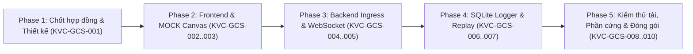

# KẾ HOẠCH PHÁT TRIỂN DASHBOARD GCS (TRẠM MẶT ĐẤT) KVC

- **Mã kế hoạch:** KVC-GCS-PLAN-001
- **Liên kết task:** KVC-GCS-001
- **Coder:** Codex hoặc Antigravity, chọn đúng một owner cho mỗi task theo AGENTS.md.
- **Reviewer:** Codex; nếu Codex cũng là author thì ghi SELF-REVIEW.
- **Tình trạng:** DEPRECATED / HISTORICAL PLAN; các task ứng dụng có thể tham khảo sau khi đối chiếu source, các task USB/STM32 không còn là kiến trúc mục tiêu.
- **Hệ thống mục tiêu:** Tải nhiệm vụ UAV tìm kiếm cứu nạn bão lũ (SAR Payload), **không phải flight controller**.
- **Tài liệu căn cứ:** `AGENTS.md`, `.agents/rules/kvc.md`, `docs/KVC_AI_WORKFLOW.md`, `docs/KVC_ThietKeHeThong.md`.

---

## 1. Hiện trạng và nguồn kế hoạch — cập nhật 14/10/2026

> **Lưu ý cập nhật 15/10/2026:** Tài liệu này được lập theo phương án STM32/CP2102/USB và lịch GCS cũ. Kiến trúc kết nối hiện hành là gateway ESP32-C3 có nguồn riêng → Wi-Fi SoftAP/WebSocket v1 → dịch vụ GCS trên laptop → Dashboard web; mã kit/module ESP32-C3 còn chờ xác minh. Các task USB/serial, sơ đồ, acceptance và gate bên dưới là **DEPRECATED cho tích hợp phần cứng hiện hành**; không giao hoặc thực hiện theo chúng. Dùng [thiết kế hệ thống](../KVC_ThietKeHeThong.md), [checklist 5 người](../planning/KVC_CONG_VIEC_CHI_TIET_5_NGUOI.md) và [data contract](KVC_GCS_DATA_CONTRACT.md) để lập task mới với owner, files, acceptance và tests cụ thể. RF 32 byte còn là draft; baseline Wi-Fi chưa được triển khai/xác minh. Các task logger/replay/frontend chỉ là tham khảo lịch sử và phải xác minh source hiện tại trước khi tiếp tục.

Snapshot tổng hợp mới tại [KVC_PROJECT_STATUS](../KVC_PROJECT_STATUS.md), KVC-STATUS-DOC-20261014-001: frontend/backend MOCK/logger/replay có source và log tests lịch sử; chưa serial ingress. G1 ABI chưa được duyệt, gate hệ thống còn BLOCKED; G0–G5 không tự PASS. Task/matrix bên dưới mô tả acceptance dự kiến, các dòng NOT RUN không phủ nhận unit tests ứng dụng đã có; cần log đúng candidate để cập nhật từng phép thử. Baseline Git đã tồn tại.

Snapshot 14/10 có **Dashboard/frontend** React/TypeScript/Vite và **Dashboard/backend** FastAPI MOCK/schema/state/WS/SQLite/replay, với tests nằm trong backend/tests, frontend/src và tests/ ở root. Chưa thấy serial ingress/parser RF/USB hoặc project RTL/MCU KVC dạng rời. Audit KVC-MAINT-20261014-001 chạy kiểm thử host và build; xem README/analysis và log audit để biết kết quả/giới hạn. Không đánh dấu toàn bộ task/gate DONE chỉ từ source.

- **Tiếp tục source frontend hiện hữu**, không tạo lại Vanilla JS hoặc index.html độc lập bỏ qua Vite.
- Backend MOCK/logger/replay đã triển khai ở tầng ứng dụng; tiếp tục source này. Serial ingress/parser là phần còn thiếu. MOCK LOCAL trong trình duyệt không thay MOCK BACKEND qua WebSocket.
- RF 32 byte/USB 48 byte tại mục IV.3 thiết kế vẫn là DESIGN, chờ C+D chốt G1. Vector review/KVC-PLAN-002_reference_vectors.json là tham chiếu lịch sử nếu còn; sao chép/xác minh thành fixture task có version/hash trước khi dùng, không phụ thuộc duy nhất thư mục review bị ignore.
- Telemetry 20 byte trong AGENTS.md là ghi nhận source cũ. MVP hiện không đặt mục tiêu parser legacy; không khôi phục hoặc suy đoán layout 20 byte, không tự đổi giao thức hardware.
- Bản [thiết kế hệ thống](../KVC_ThietKeHeThong.md) hiện tại không chứa lịch 21 ngày; mục VII là nghiệm thu. Ngày/gate A–E trong kế hoạch này là tham chiếu lịch sử, không tự coi là hạn mới đã chốt. Thịnh phụ trách GCS/MCU đất theo [checklist 5 người](../planning/KVC_CONG_VIEC_CHI_TIET_5_NGUOI.md); Phong/Vững cùng chốt ABI, Cường hỗ trợ lắp/đo.
- D xác nhận tình trạng từng task bằng evidence mới trước khi sửa: các task frontend có source liên quan không được mặc định là PROPOSED chưa làm hoặc DONE đã đạt. Owner coder là Codex hoặc Antigravity được chọn cho từng task; chỉ một writer trong scope, D chịu trách nhiệm nghiệm thu phân hệ.

“Sa bàn” trong backlog kỹ thuật là cách gọi local grid cũ; demo hiện hành gồm hai video và live không sa bàn theo [kịch bản](../demo/KVC_DEMO.md). Cấu hình dùng OneKiwi V1.1, Sonix tải và phương án STM32F103C8T6 + CP2102 ở đất.

Các đầu vào cần chốt trước tích hợp: người phụ trách D và giờ công, COM/baud của bridge, device/session identifiers, pose/origin local và ABI. Chưa có hardware thì REAL BLOCKED, vẫn phát triển MOCK độc lập với nhãn rõ.

---

## 2. Mục tiêu và phạm vi MVP của Dashboard GCS

### 2.1. Mục tiêu cốt lõi
Dashboard GCS là trạm mặt đất đóng vai trò **giám sát dữ liệu tải nhiệm vụ (Payload Telemetry & Mission Monitoring)**, hỗ trợ lực lượng cứu nạn quan sát hiện trường, phát hiện nạn nhân trôi dạt và lưu trữ bằng chứng.

### 2.2. Phạm vi trong MVP (In-Scope)
1. **Theo dõi kết nối 2 tầng độc lập:**
   - Tầng 1: Trình duyệt Web $\leftrightarrow$ GCS Backend (WebSocket link).
   - Tầng 2: GCS Backend $\leftrightarrow$ Thiết bị phần cứng / Nguồn dữ liệu (Hardware Serial Link / Ground Dongle).
2. **Quản lý nguồn dữ liệu tường minh (Source Isolation):**
   - Phân biệt rõ 3 chế độ: `REAL` (phần cứng thật), `MOCK` (bộ tạo dữ liệu giả lập), `REPLAY` (phát lại nhật ký).
   - Ghi rõ nhãn chữ và màu sắc; chế độ `REAL` tuyệt đối không tự động âm thầm fallback sang `MOCK`.
3. **Hiển thị Telemetry và Trạng thái Cảm biến:**
   - Nhận diện trạng thái nguồn pin, cự ly siêu âm AJ-SR04M, cờ hợp lệ (`GPS_VALID`, `ALT_VALID`, `IMU_VALID`, `AI_DETECTED`, `POS_VALID`).
   - Tính toán và hiển thị tuổi dữ liệu nhận tại PC (`rx_age_ms`).
   - Đánh dấu trạng thái `STALE` khi không nhận được gói tin mới quá 3 giây.
4. **Hiển thị Mục tiêu trên Radar Hệ local XY:**
   - Vẽ tọa độ mục tiêu cứu nạn trên không gian sa bàn cục bộ (hệ trục $X-Y$ đơn vị cm hoặc m).
   - Chỉ vẽ mục tiêu khi cờ `LOCAL_FRAME_ACTIVE=1` và `POS_VALID=1`.
   - Hiển thị thông tin nhận diện: Lớp đối tượng (`person`, `lifebuoy`), độ tin cậy (`confidence`), mã bám vết (`track_id`).
5. **Hiển thị Tọa độ Toàn cầu (WGS-84):**
   - Chỉ hiển thị Kinh độ / Vĩ độ khi `LOCAL_FRAME_ACTIVE=0` và `GPS_VALID=1` kèm `POS_VALID=1`.
   - Nếu GNSS mất fix hoặc đang ở chế độ local local, ô GPS bắt buộc hiển thị `N/A`, tuyệt đối không đưa tọa độ $X-Y$ cục bộ vào ô Kinh độ / Vĩ độ.
6. **Bảng Cảnh báo và Sự kiện (Alert Log):**
   - Lọc và hiển thị các sự kiện phát hiện nạn nhân (`AI_DETECTED=1`, `TARGET_CONFIRMED=1`), sự kiện mất liên kết, lỗi cảm biến.
   - Có cơ chế chống trùng lặp cảnh báo (dedup) và gắn nhãn thời gian rõ ràng.
7. **Lưu trữ Nhật ký Bền vững và Replay:**
   - Ghi nhận bản tin accept/reject vào SQLite trong giới hạn queue, báo rõ drop khi quá tải; lưu vào cơ sở dữ liệu SQLite cục bộ (chế độ WAL, `synchronous=FULL`).
   - Tách biệt luồng ghi log, bảo đảm không làm nghẽn luồng đọc dữ liệu thời gian thực.
   - Hỗ trợ phát lại phiên (Replay) với đồng hồ ảo (`virtual_clock`), cho phép tạm dừng (Pause), tua (Seek) mà không gửi bất kỳ lệnh nào xuống cổng phần cứng.
8. **Khả năng Vận hành 100% Offline:**
   - Toàn bộ thư viện CSS, JavaScript, font chữ, icon và tài nguyên đồ họa được đóng gói cục bộ.
   - Radar local vẽ trên Canvas/SVG thuần, hoạt động trơn tru khi máy tính ngắt hoàn toàn kết nối Internet (WAN off, cache rỗng).

### 2.3. Phạm vi loại trừ khỏi MVP (Out-of-Scope)
- **Điều khiển bay và UAV:** Không có tính năng điều khiển bay, lái hướng, lập kế hoạch bay (waypoint navigation), gửi lệnh arm/disarm hoặc can thiệp autopilot (như ArduPilot/PX4).
- **Luồng Video Trực tiếp:** Không thu nhận hoặc giải mã video độ nét cao qua LoRa. (Nếu có webcam tham chiếu trên laptop dã chiến, luồng này chỉ mang tính phụ trợ cục bộ và không được tạo cảnh báo thật).
- **Bản đồ trực tuyến diện rộng:** Không tải tile động từ máy chủ OpenStreetMap công cộng (tuân thủ [S12] OSM Tile Usage Policy).
- **Thống kê phân tích đa mục tiêu phức tạp:** Không thực hiện tính toán vector dòng trôi (drift vector) hoặc bám vết đa mục tiêu (chỉ theo dõi 1 mục tiêu ưu tiên trong MVP).

---

## 3. Bố cục và trải nghiệm giao diện người dùng (Frontend UI/UX)

### 3.1. Đáp ứng độ phân giải màn hình
Giao diện được thiết kế tối ưu cho 2 chuẩn màn hình phổ biến của máy tính chỉ huy dã chiến:
1. **1366 × 768 (Laptop nhỏ/cũ dã chiến):** Tận dụng tối đa chiều ngang, chia lưới 3 cột cô đọng, thanh cuộn nội bộ cho từng panel, cỡ chữ tối thiểu 12px, độ tương phản cao phục vụ quan sát ngoài trời.
2. **1920 × 1080 (Màn hình chuẩn Full HD):** Không gian mở rộng cho radar local kích thước lớn, hiển thị đồng thời đồ thị chất lượng tín hiệu (RSSI/SNR) và bảng kiểm tra raw packet.

### 3.2. Sơ đồ bố cục giao diện (Wireframe Grid)

```text
+----------------------------------------------------------------------------------------------------+
| [1] TOP STATUS BAR: Phiên: SES-20261012-01 | Mode: [MOCK] | Backend: [CONNECTED] | HW: [DISCONNECTED] |
|     Gói nhận: 1.240 | Lỗi: 2 | Dropped: 0 | Tuổi dữ liệu: 0.8s [FRESH] | Giờ hệ thống: 14:30:15     |
+--------------------------------------------------+-------------------------------------------------+
| [2] VÙNG QUAN SÁT CHÍNH (MAIN VIEWPORT)          | [3] BẢNG THÔNG SỐ ĐO (TELEMETRY & TARGET)       |
|                                                  |                                                 |
| +----------------------------------------------+ | +-- MỤC TIÊU HIỆN TẠI (SELECTED TARGET) ------+ |
| | RADAR SA BÀN CỤC BỘ (LOCAL XY GRID)          | | | Track ID: #104      | Loại: Người (person)   | |
| |                                              | | | Tọa độ X: +125.4 cm | Tọa độ Y: -45.2 cm     | |
| |               +Y (Bắc local)                | | | Độ tin cậy: 92%     | Trạng thái: CONFIRMED  | |
| |                      |                       | | +--------------------------------------------+ |
| |                      |    [X] Target #104    | |                                                 |
| |       -X ------------+------------ +X        | | +-- TỌA ĐỘ TOÀN CẦU GNSS (WGS-84) -----------+ |
| |                      |                       | | | Vĩ độ (Lat):  N/A (Chế độ local cục bộ)   | |
| |                      |                       | | | Kinh độ (Lon): N/A (Chế độ local cục bộ)   | |
| |               -Y (Nam local)                | | | GNSS Fix:     INVALID / NO FIX             | |
| |                                              | | +--------------------------------------------+ |
| | Thước tỉ lệ: [ 1 ô = 50 cm ]                 | |                                                 |
| | Gốc O: Cột mốc A (Manifest ID: 0x01)         | | +-- TRẠNG THÁI KHÍ TÀI (PAYLOAD HEALTH) -----+ |
| +----------------------------------------------+ | | Pin tải: 82%        | Siêu âm Range: 245 cm| |
|                                                  | | IMU: VALID          | Tín hiệu LoRa: -92dBm | |
+--------------------------------------------------+-------------------------------------------------+
| [4] BẢNG NHẬT KÝ CẢNH BÁO (ALERTS & EVENTS)      | [5] ĐIỀU KHIỂN PHIÊN & REPLAY (SESSION / LOG)   |
| 14:29:50 [CẢNH BÁO] Phát hiện mục tiêu Track#104 | Phiên hiện tại: rec_20261012_142500.db          |
| 14:29:48 [TRẠNG THÁI] Kết nối MOCK thành công    | Nút: [ Bắt đầu phiên mới ] [ Xuất JSONL ]       |
| 14:28:10 [HỆ THỐNG] Khởi tạo GCS Engine          | Replay: [► Chạy] [❚❚ Tạm dừng] | Tốc độ: 1x    |
|                                                  | Thanh trượt tua: [====o----------------] 24%    |
+--------------------------------------------------+-------------------------------------------------+
```

### 3.3. Các trạng thái giao diện và nguyên tắc xử lý dữ liệu
1. **Nguyên tắc `N/A` tuyệt đối:**
   - Trường dữ liệu chưa nhận được, bị lỗi kiểm tra hoặc không hợp lệ bắt buộc hiển thị ký tự `N/A` (Not Available) hoặc `--`.
   - **Tuyệt đối không thay thế dữ liệu thiếu bằng số `0`** (vì $X=0, Y=0$ là điểm gốc tọa độ thực tế trên sa bàn; Lat=0, Lon=0 là vị trí trên biển Đại Tây Dương).
2. **Nhãn trạng thái kép (Màu sắc + Chữ viết):**
   - Tuân thủ nguyên tắc trợ năng (Accessibility): Không dùng màu sắc đơn thuần để biểu đạt trạng thái.
   - Ví dụ: `[XANH] HOẠT ĐỘNG (CONNECTED)`, `[VÀNG] CHẬM (STALE)`, `[ĐỎ] MẤT KẾT NỐI (DISCONNECTED)`, `[XÁM] KHÔNG CÓ DỮ LIỆU (N/A)`.
3. **Cơ chế phát hiện dữ liệu cũ (`STALE`):**
   - Bộ đếm thời gian tại trình duyệt theo dõi khoảng cách từ thời điểm nhận gói tin hợp lệ gần nhất.
   - Nếu quá **3,0 giây** không có gói tin mới:
     - Gắn cờ cảnh báo `STALE` màu vàng kèm nhãn chữ `DỮ LIỆU CŨ (>3s)`.
     - Vị trí mục tiêu trên radar bị mờ đi (opacity giảm 50%) và gạch chéo để chỉ thị vị trí không còn cập nhật thời gian thực.
     - Giữ nguyên tọa độ cũ kèm cảnh báo, không xóa đột ngột khỏi màn hình gây giật mắt người quan sát.
4. **Tách biệt kết nối 2 tầng:**
   - Nếu mất WebSocket giữa Trình duyệt và Backend: Hiển thị thanh cảnh báo đỏ đầu trang: `MẤT KẾT NỐI BACKEND (Đang thử lại...)`. Toàn bộ dữ liệu chuyển sang trạng thái đông kết (Frozen).
   - Nếu WebSocket thông nhưng cổng Serial mất tín hiệu phần cứng: Trình duyệt hiển thị Backend `CONNECTED` nhưng Phần cứng `DISCONNECTED / NO SIGNAL`.
5. **Cách ly tọa độ cục bộ và tọa độ toàn cầu:**
   - Khi cờ `LOCAL_FRAME_ACTIVE=1`: Radar local vẽ theo trục $X-Y$ (cm/m). Khối hiển thị GNSS WGS-84 ghi rõ `N/A (Local Grid Active)`.
   - Khi cờ `LOCAL_FRAME_ACTIVE=0` và `GPS_VALID=1`: Bản đồ WGS-84 hiển thị tọa độ. Radar local ghi rõ `N/A (Global Frame Active)` và không tự ý vẽ điểm ảo.

---

## 4. Kiến trúc Backend và luồng xử lý dữ liệu

### 4.1. Sơ đồ khối luồng dữ liệu Backend

```text
[ NGUỒN DỮ LIỆU ]
   +-- Chế độ REAL   ---> Cổng Serial / CP2102 USB-UART (48-byte envelopes)
   +-- Chế độ MOCK   ---> Fixture Generator (Bộ sinh frame giả lập)
   +-- Chế độ REPLAY ---> SQLite Reader (Đọc log cũ theo virtual clock)
           |
           v
[ 1. TẦNG THU NHẬN & FRAMING (INGRESS & FRAMER) ]
   - Bộ đệm vòng byte: 4.096 bytes
   - Đồng bộ khung: Tìm Sync AA 7E, kiểm tra Length = 43, kiểm tra Envelope CRC-16
   - Ingress FIFO: Dung lượng hữu hạn 256 envelopes (Mỗi envelope 48 bytes)
   - Chính sách tràn: Drop envelope MỚI NHẤT, tăng bộ đếm `ingress_drops`, kích hoạt cờ `DATA_LOSS`
           |
           v
[ 2. TẦNG GIẢI MÃ & KIỂM TRA (PARSER & VALIDATOR) ]
   - Tách Envelope metadata (Ground session, RX time, RSSI, SNR, RF CRC status)
   - Kiểm tra RF payload (32 bytes): Sync AA 55, Version = 1, CRC-16 CCITT
   - Lọc bản tin theo Session & Sequence: Loại bỏ bản tin trễ ngoài cửa sổ
   - Trích xuất dữ liệu: Phân tách Telemetry (Type 0x01), Target (0x02), Status (0x03)
           |
           +-----------------------------------------------+
           |                                               |
           v                                               v
[ 3. TẦNG QUẢN LÝ TRẠNG THÁI (STATE REDUCER) ]   [ 4. TẦNG LƯU TRỮ (LOGGER WORKER) ]
   - Quản lý trạng thái phiên hiện hành             - Luồng ghi độc lập (Worker thread)
   - Telemetry slot: Latest-wins (chỉ giữ bản mới)  - Hàng đợi ghi: Tối đa 1.024 records
   - Target tracker: 1 mục tiêu hiện thời           - SQLite WAL mode, PRAGMA synchronous=FULL
   - Khử trùng lặp cảnh báo (Dedup 10s TTL)         - Gom nhóm commit: Mỗi 1s hoặc 100 records
   - Tính toán tuổi dữ liệu (`rx_age_ms`)           - Đầy hàng đợi: Drop record, tăng `log_drops`,
           |                                          chuyển trạng thái sang `LOG_DEGRADED`
           v
[ 5. TẦNG PHÂN PHỐI WEBSOCKET (DISPATCHER) ]
   - Quản lý danh sách client kết nối (Tối đa 4 clients)
   - Mỗi client sở hữu hàng đợi sự kiện độc lập (Dung lượng 64 events)
   - Send timeout: 1,0 giây cho mỗi lượt gửi
   - Quá tải client: Ngắt kết nối client chậm với lý do `client_overflow`
   - Client kết nối lại: Gửi ngay gói trạng thái Snapshot đầy đủ
```

### 4.2. Các nguyên tắc thiết kế bất biến của Backend
1. **Không chờ đợi (Non-blocking Ingress):**
   - Luồng đọc cổng nối tiếp (Serial Reader) chạy độc lập, đọc non-blocking và đẩy vào hàng đợi Ingress FIFO.
   - Tuyệt đối không để độ trễ của giao diện Web, lỗi mạng WebSocket hay tác vụ ghi đĩa làm chậm luồng đọc phần cứng.
2. **Bộ đệm hữu hạn và minh bạch thất thoát:**
   - Mọi hàng đợi trong hệ thống đều có giới hạn cứng:
     - Ingress FIFO: 256 phần tử.
     - Logger Queue: 1.024 phần tử.
     - Client Alert Queue: 64 phần tử.
   - Khi đầy hàng đợi: Thực thi chính sách Drop quy định trước, ghi nhận vào các biến đếm `ingress_drops`, `log_drops`, `client_drops` và phát thông báo `DATA_LOSS` về giao diện người dùng.
   - *Ghi chú:* Các con số 256, 1.024, 64 là tham số thiết kế lý thuyết cần được kiểm chứng qua bài test tải thực tế, không coi là minh chứng hệ thống đã ổn định.
3. **Chiến lược Telemetry Latest-Wins:**
   - Dữ liệu đo xa (Telemetry) mang tính thời điểm tức thời. Khi hệ thống nhận gói tin mới, giá trị cũ trong State Reducer được ghi đè trực tiếp. Trình duyệt chỉ cần nhận trạng thái mới nhất, tránh tích lũy dữ liệu telemetry cũ gây trễ hiển thị.
4. **Cô lập luồng ghi đĩa (Durability vs Performance):**
   - SQLite được cấu hình chế độ WAL (Write-Ahead Logging) và `synchronous=FULL` để bảo vệ dữ liệu chống hỏng hóc khi mất nguồn đột ngột.
   - Logger gom nhóm transaction tối đa 1 giây hoặc 100 bản ghi. Không cam kết mất dữ liệu dưới 1 giây chỉ dựa trên chu kỳ flush lý thuyết; độ bền dữ liệu phải được xác nhận bằng bài test cưỡng bức ngắt tiến trình (kill-process test).
5. **Cô lập chế độ nghiêm ngặt (Zero Auto-Fallback):**
   - Khi cấu hình chế độ `REAL`: Backend chỉ nhận dữ liệu từ cổng phần cứng đã chỉ định. Nếu mất kết nối phần cứng, hệ thống báo `LINK_LOST`, tuyệt đối không tự động chuyển sang chế độ `MOCK`.
   - Khi cấu hình chế độ `REPLAY`: Backend tuyệt đối không mở cổng serial ở chế độ ghi (write), không gửi bất kỳ byte dữ liệu nào xuống phần cứng.

---

## 5. Đánh giá công nghệ và cấu trúc thư mục đề xuất

### 5.1. Đánh giá lựa chọn công nghệ
1. **Backend:**
   - **Lựa chọn:** Python 3.13 với **FastAPI** và **Uvicorn** (hoặc module `asyncio` chuẩn).
   - **Lý do:** FastAPI hỗ trợ WebSocket bất đồng bộ hiệu năng cao, tích hợp Pydantic cho việc xác thực schema dữ liệu theo Data Contract, dễ viết unit test bằng `pytest`. Thư viện `pyserial` hoặc `asyncserial` phục vụ đọc cổng COM.
2. **Cơ sở dữ liệu:**
   - **Lựa chọn:** **SQLite** tích hợp sẵn trong Python standard library.
   - **Lý do:** Không cần cài đặt server dịch vụ phức tạp (Zero-configuration), lưu trữ gọn trong 1 file `.db`, hỗ trợ cơ chế WAL tối ưu hóa ghi đồng thời và dễ dàng đóng gói sao lưu cho bài kiểm tra nghiệm thu dã chiến.
3. **Frontend:**
   - **Lựa chọn theo source hiện có:** **React + TypeScript + Vite**, Tailwind CSS và các component UI trong frontend.
   - **Lý do:** Giữ code hiện hữu và lockfile, kiểm thử/build rồi đóng gói offline. Không viết lại framework trong lịch 21 ngày; npm build/dependency là bước cần kiểm, không mặc định đã chạy.
   - **Radar Canvas:** Tự vẽ bằng HTML5 Canvas 2D API hoặc SVG, bảo đảm 100% không phụ thuộc Internet.
   - **Bản đồ (Tùy chọn):** Leaflet được lưu file cục bộ (`leaflet.js`, `leaflet.css`), chỉ kích hoạt khi có bản đồ offline hợp lệ.

### 5.2. Cấu trúc thư mục đề xuất cho `Dashboard/`
Frontend đã tồn tại; backend, fixtures và tests Python dưới đây là đề xuất. Allowed files phải được chốt thành tệp cụ thể trong từng task.

```text
d:\Project_UAV_KVC\Dashboard\
├── backend\
│   ├── app.py                   # Điểm khởi chạy FastAPI, cấu hình CORS, lifespan
│   ├── config.py                # Cấu hình cổng COM, baudrate, đường dẫn DB, tham số hàng đợi
│   ├── models.py                # Schema dữ liệu Pydantic theo KVC_GCS_DATA_CONTRACT.md
│   ├── serial_ingress.py        # Luồng đọc cổng nối tiếp, framing USB envelope 48 byte
│   ├── packet_decoder.py        # Giải mã RF payload 32 byte, tính CRC-16, kiểm tra hợp lệ
│   ├── state_manager.py         # Quản lý máy trạng thái, one-target tracking, khử trùng lặp
│   ├── sqlite_logger.py         # Ghi log nền vào SQLite WAL, sao lưu, trích xuất JSONL
│   ├── mock_generator.py        # Bộ tạo tín hiệu MOCK phục vụ kiểm thử và phát triển
│   ├── replay_engine.py         # Trình phát lại dữ liệu từ file SQLite theo virtual clock
│   └── ws_dispatcher.py         # Quản lý WebSocket clients, phát sóng bản tin, snapshot
│
├── frontend\                    # ĐÃ CÓ: tiếp tục source hiện hữu
│   ├── package.json             # Scripts dev/build/typecheck/test/lint
│   ├── package-lock.json        # Dependency lock
│   ├── src/app/                 # App shell và routes
│   ├── src/features/            # Radar, map, telemetry, alerts, settings
│   ├── src/services/            # Telemetry client/adapter
│   ├── src/state/               # Provider/reducer
│   ├── src/types/               # Contract TypeScript
│   ├── src/mocks/               # MOCK phía trình duyệt
│   ├── public/                  # Assets cục bộ
│   └── tests/                   # Scripts kiểm tra browser hiện có
│
├── fixtures\
│   ├── golden_packets.json      # Bộ vector hex chuẩn để test giải mã
│   └── mock_flight_session.db   # File log SQLite mẫu phục vụ kiểm thử Replay
│
└── tests\
    ├── test_usb_framer.py       # Kiểm thử bắt khung 48 byte, xử lý byte rác
    ├── test_rf_decoder.py       # Kiểm thử giải mã 32 byte, CRC, kiểm tra các loại cờ
    ├── test_state_reducer.py    # Kiểm thử máy trạng thái, xử lý STALE, latest-wins
    ├── test_sqlite_logger.py    # Kiểm thử ghi log, phục hồi lỗi, commit WAL
    └── test_websocket_flow.py   # Kiểm thử kết nối WebSocket, snapshot, client chậm
```

---

> Các đường dẫn ở cây đề xuất là DESIGN, không phải inventory. Source hiện hành có state.py, schemas.py, sqlite_logger.py và replay_engine.py; đối chiếu trước giao task để không tạo module trùng.

## 6. Các giai đoạn phát triển và Phân chia Task chi tiết

Kế hoạch được chia thành 5 giai đoạn nối tiếp. Nguyên tắc tối cao: **Xây dựng ngay luồng mỏng (Walking Skeleton)** ở Phase 2 & 3: `MOCK -> Backend Ingress -> WebSocket -> Radar Canvas` để chứng minh giải pháp trước khi mở rộng.



---

### Giai đoạn 1: Chốt hợp đồng dữ liệu và khảo sát thiết kế

#### Task KVC-GCS-001 (Hồ sơ lập kế hoạch ban đầu)
- **Scope:** Khảo sát trực tiếp workspace; lập kế hoạch tổng thể `docs/gcs/KVC_GCS_PLAN.md`; soạn thảo hợp đồng dữ liệu `docs/gcs/KVC_GCS_DATA_CONTRACT.md`; lập báo cáo kết quả `review/KVC-GCS-001-PLANNING-REPORT.md`.
- **Out of scope:** Không viết mã nguồn ứng dụng, không cài dependency, không chạy ứng dụng, không can thiệp phần cứng.
- **Owner duy nhất:** Codex hoặc Antigravity do người dùng chọn trước triển khai.
- **Allowed files:**
  - `docs/gcs/KVC_GCS_PLAN.md`
  - `docs/gcs/KVC_GCS_DATA_CONTRACT.md`
  - `review/KVC-GCS-001-PLANNING-REPORT.md`
- **Dependencies / Đầu vào:** `AGENTS.md`, `docs/KVC_AI_WORKFLOW.md`, `docs/KVC_ThietKeHeThong.md`.
- **Acceptance criteria:**
  1. Ghi snapshot đúng thời điểm: ngày 11/10 source cũ đã xóa; ngày 14/10 có frontend và backend MOCK/logger/replay; phần serial còn thiếu. Không tiếp tục dùng kết luận thiếu toàn bộ Dashboard.
  2. Kế hoạch GCS phân định rõ mục tiêu, kiến trúc, bố cục UI, các giai đoạn và task con.
  3. Hợp đồng dữ liệu định nghĩa đầy đủ schema, ý nghĩa trường, quy tắc null, tọa độ, API và 7 ví dụ minh họa.
  4. Báo cáo kiểm tra ghi nhận trung thực lệnh chạy, exit code và trạng thái `PLAN_READY`.
- **Tests dự kiến:** Kiểm tra cú pháp tài liệu, `git diff --check`, `git status --short`.
- **Status ban đầu:** PLANNING $\rightarrow$ Hoàn thành chuyển sang `PLAN_READY`.
- **Sản phẩm bàn giao:** 3 file tài liệu hoàn chỉnh.

---

### Giai đoạn 2: Phát triển Frontend độc lập với nguồn MOCK

#### Task KVC-GCS-002: Khởi tạo Skeleton giao diện và Bộ vẽ Radar Hệ local
- **Scope:** Tiếp tục React/TypeScript hiện có; kiểm và hoàn thiện module Radar local theo tọa độ cục bộ; hiển thị lưới tọa độ, các vòng cự ly local, hiển thị mục tiêu từ dữ liệu giả lập tĩnh.
- **Out of scope:** Chưa kết nối WebSocket thật, chưa xử lý kết nối cổng serial.
- **Owner duy nhất:** Codex hoặc Antigravity do người dùng chọn trước triển khai.
- **Allowed files (Đề xuất):**
  - `Dashboard/frontend/index.html`
  - `Dashboard/frontend/src/index.css`
  - `Dashboard/frontend/src/features/radar/LocalRadarPanel.tsx`
  - `Dashboard/frontend/src/app/App.tsx`
- **Dependencies / Đầu vào:** Kế hoạch `KVC_GCS_PLAN.md`, hợp đồng `KVC_GCS_DATA_CONTRACT.md`.
- **Acceptance criteria:**
  1. Chạy qua Vite dev hoặc production preview; layout không vỡ ở 1366×768 và 1920×1080; không mở index.html trực tiếp bằng file://.
  2. Radar Canvas vẽ đúng hệ trục tọa độ local (+X hướng Đông, +Y hướng Bắc), vẽ điểm mục tiêu giả lập với màu sắc rõ ràng.
  3. Hoạt động 100% offline, không báo lỗi thiếu tài nguyên ngoài mạng.
- **Tests dự kiến:** Kiểm tra render trên trình duyệt (Headless hoặc manual inspection), kiểm tra tương thích CSS.
- **Status cập nhật 14/10:** CÓ SOURCE VÀ TEST HOST; CẦN BROWSER/HARDWARE/GATE EVIDENCE trước khi kết luận DONE.
- **Sản phẩm bàn giao:** Frontend hiện có đã kiểm/hoàn thiện, kèm build và test evidence.

#### Task KVC-GCS-003: Xây dựng Bộ tạo dữ liệu giả lập (MOCK Fixture Generator)
- **Scope:** Tạo script Python sinh chuỗi dữ liệu giả lập (MOCK Stream) mô phỏng tải nhiệm vụ UAV: di chuyển mục tiêu trên local, thay đổi pin, thay đổi cự ly siêu âm, giả lập kịch bản mất GNSS, kịch bản mục tiêu mất dấu.
- **Out of scope:** Chưa nối vào cổng serial thật.
- **Owner duy nhất:** Codex hoặc Antigravity do người dùng chọn trước triển khai.
- **Allowed files (Đề xuất):**
  - `Dashboard/backend/mock_generator.py`
  - `Dashboard/fixtures/golden_packets.json`
  - `Dashboard/tests/test_mock_generator.py`
- **Dependencies / Đầu vào:** `docs/gcs/KVC_GCS_DATA_CONTRACT.md`.
- **Acceptance criteria:**
  1. Bộ sinh MOCK backend tạo đúng JSON và fixture nhị phân 32/48 theo ABI thiết kế đã chốt; MOCK trình duyệt hiện có được giữ riêng, không coi đã thay nhiệm vụ này.
  2. Hỗ trợ các kịch bản: mục tiêu bình thường, mục tiêu ngoài tầm, cảm biến invalid, dữ liệu stale.
  3. Unit test xác nhận tính đơn điệu của sequence và timestamp.
- **Tests dự kiến:** `pytest Dashboard/tests/test_mock_generator.py`.
- **Status ban đầu:** PROPOSED.
- **Sản phẩm bàn giao:** Module `mock_generator.py` và bộ vector mẫu.

---

### Giai đoạn 3: Backend Ingress, State Reducer và Tích hợp WebSocket

#### Task KVC-GCS-004: Xây dựng Bộ tách khung USB và Giải mã RF Payload
- **Scope:** Hiện thực hóa module bắt khung USB Ground Envelope (48 byte) qua bộ đệm vòng; kiểm tra độ dài và CRC-16; hiện thực hóa module giải mã RF payload (32 byte), kiểm tra CRC-16 CCITT, bóc tách các trường telemetry, target, flags.
- **Out of scope:** Chưa kết nối cổng COM thật, chưa lưu database.
- **Owner duy nhất:** Codex hoặc Antigravity do người dùng chọn trước triển khai.
- **Allowed files (Đề xuất):**
  - `Dashboard/backend/serial_ingress.py`
  - `Dashboard/backend/packet_decoder.py`
  - `Dashboard/tests/test_usb_framer.py`
  - `Dashboard/tests/test_rf_decoder.py`
- **Dependencies / Đầu vào:** Contract ứng dụng, ABI mục IV.3 thiết kế được C+D chốt ở G1; fixture phiên bản hóa tại Dashboard/fixtures/golden_packets.json. Vector trong review chỉ là đầu vào tham khảo cần xác minh.
- **Acceptance criteria:**
  1. Vượt bộ golden C/Python đã khóa version/hash và đủ lỗi CRC/length/session/origin; một vector tham chiếu đơn lẻ không đủ nghiệm thu parser.
  2. Bắt đúng khung khi dữ liệu bị cắt đôi (split chunks), bị dính nhiều khung (concatenated frames) hoặc chèn byte rác ở đầu.
  3. Từ chối và ghi nhận lỗi khi CRC sai hoặc độ dài khác 48 bytes mà không làm sập tiến trình.
- **Tests dự kiến:** `pytest Dashboard/tests/test_usb_framer.py Dashboard/tests/test_rf_decoder.py`.
- **Status ban đầu:** PROPOSED.
- **Sản phẩm bàn giao:** 2 module giải mã và bộ unit test kiểm thử giao thức.

#### Task KVC-GCS-005: Xây dựng State Reducer, WebSocket Dispatcher và Kết nối Frontend
- **Scope:** Hiện thực hóa bộ quản lý trạng thái phiên (`state_manager.py`); quản lý hàng đợi kết nối WebSocket; phát sóng sự kiện thời gian thực; tích hợp telemetryClient/adapter và MissionProvider ở frontend hiện có để nhận dữ liệu và hiển thị trực tiếp lên Radar Canvas và Bảng thông số.
- **Out of scope:** Chưa ghi log vào SQLite.
- **Owner duy nhất:** Codex hoặc Antigravity do người dùng chọn trước triển khai.
- **Allowed files (Đề xuất):**
  - `Dashboard/backend/app.py`
  - `Dashboard/backend/state_manager.py`
  - `Dashboard/backend/ws_dispatcher.py`
  - `Dashboard/frontend/src/services/telemetryClient.ts`
  - `Dashboard/frontend/src/state/MissionProvider.tsx`
  - `Dashboard/tests/test_state_reducer.py`
  - `Dashboard/tests/test_websocket_flow.py`
- **Dependencies / Đầu vào:** Task KVC-GCS-002, KVC-GCS-003, KVC-GCS-004.
- **Acceptance criteria:**
  1. Hoàn thành luồng Walking Skeleton: Chạy Backend với MOCK, mở Frontend, radar hiển thị mục tiêu di chuyển mượt mà qua WebSocket.
  2. Client ngắt kết nối và kết nối lại nhận ngay gói Snapshot trạng thái đầy đủ.
  3. Quá 3 giây không có dữ liệu mới, giao diện chuyển trạng thái `STALE` chính xác.
- **Tests dự kiến:** Unit test Backend và kiểm tra tương tác WebSocket client.
- **Status ban đầu:** PROPOSED.
- **Sản phẩm bàn giao:** Luồng tích hợp End-to-End đầu tiên của GCS.

---

### Giai đoạn 4: SQLite Logger, Replay Engine và Xử lý lỗi/Phục hồi

#### Task KVC-GCS-006: Xây dựng Bộ ghi nhật ký bền vững SQLite (SQLite Logger)
- **Scope:** Hiện thực hóa luồng ghi nhật ký độc lập sử dụng SQLite ở chế độ WAL và `synchronous=FULL`; hàng đợi ghi có giới hạn 1.024 records; xử lý commit theo chu kỳ 1s hoặc 100 records; ghi nhận bản tin thô và bản tin đã giải mã; cơ chế xuất file JSONL phục vụ đối chiếu.
- **Out of scope:** Chưa xây dựng tính năng tua phát lại (Replay UI).
- **Owner duy nhất:** Codex hoặc Antigravity do người dùng chọn trước triển khai.
- **Allowed files (Đề xuất):**
  - `Dashboard/backend/sqlite_logger.py`
  - `Dashboard/tests/test_sqlite_logger.py`
- **Dependencies / Đầu vào:** Task KVC-GCS-005.
- **Acceptance criteria:**
  1. Writer riêng, enqueue không block và queue hữu hạn; thử đĩa chậm/đầy, đo drop/latency. Không cam kết mọi record được lưu khi queue overflow.
  2. Kiểm tra tính toàn vẹn cơ sở dữ liệu sau khi giả lập dừng đột ngột (kill process).
  3. Xuất khẩu toàn bộ phiên ra file `.jsonl` đúng chuẩn format trao đổi.
- **Tests dự kiến:** `pytest Dashboard/tests/test_sqlite_logger.py`.
- **Status ban đầu:** PROPOSED.
- **Sản phẩm bàn giao:** Module `sqlite_logger.py` và bộ test tính bền bỉ của dữ liệu.

#### Task KVC-GCS-007: Xây dựng Trình phát lại Nhật ký (Replay Engine) và Giao diện Điều khiển
- **Scope:** Xây dựng module đọc dữ liệu từ file SQLite cũ theo đồng hồ ảo (`virtual_clock`); hỗ trợ điều chỉnh tốc độ (1x, 2x, 0.5x), tạm dừng (Pause), nhảy mốc thời gian (Seek); tích hợp thanh trượt Replay trên giao diện người dùng; bảo đảm Replay không gửi bất kỳ byte nào xuống cổng phần cứng.
- **Out of scope:** Không can thiệp vào dữ liệu đang ghi trực tiếp.
- **Owner duy nhất:** Codex hoặc Antigravity do người dùng chọn trước triển khai.
- **Allowed files (Đề xuất):**
  - `Dashboard/backend/replay_engine.py`
  - `Dashboard/frontend/src/features/replay/ReplayControls.tsx (đề xuất mới)`
  - `Dashboard/tests/test_replay_engine.py`
- **Dependencies / Đầu vào:** Task KVC-GCS-006.
- **Acceptance criteria:**
  1. Phát lại phiên log mô phỏng đúng khoảng thời gian gốc giữa các gói tin.
  2. Khi Seek đến mốc thời gian mới: State Reducer được reset sạch và tái lập trạng thái đúng tại mốc đó, không lưu giữ các mục tiêu của tương lai.
  3. Nhãn trạng thái hiển thị rõ rệt `REPLAY (VIRTUAL CLOCK)` trên toàn giao diện.
- **Tests dự kiến:** `pytest Dashboard/tests/test_replay_engine.py`.
- **Status ban đầu:** PROPOSED.
- **Sản phẩm bàn giao:** Tính năng Replay hoàn chỉnh trên Backend và Frontend.

---

### Giai đoạn 5: Kiểm thử tải, Tích hợp phần cứng USB và Đóng gói bàn giao

#### Task KVC-GCS-008: Kiểm thử tải quá ngưỡng và Phục hồi lỗi hàng đợi
- **Scope:** Thực hiện bài kiểm tra tải với tập 10.000 frame nhị phân; mô phỏng tình huống client Web bị treo (slow client); mô phỏng hàng đợi Ingress đầy và Logger đầy; kiểm tra độ ổn định bộ nhớ trong phiên chạy dài 2 giờ (soak test).
- **Out of scope:** Chưa kết nối thiết bị phần cứng thật trên local.
- **Owner duy nhất:** Codex hoặc Antigravity do người dùng chọn trước triển khai.
- **Allowed files (Đề xuất):**
  - `Dashboard/tests/test_stress_load.py`
  - `Dashboard/tests/test_fault_recovery.py`
- **Dependencies / Đầu vào:** Toàn bộ mã nguồn từ Task KVC-GCS-002 đến KVC-GCS-007.
- **Acceptance criteria:**
  1. Chạy 10.000 frame: Không rò rỉ bộ nhớ (memory leak), không xảy ra deadlock giữa các luồng.
  2. Khi hàng đợi đầy: Bộ đếm drop tăng chính xác, cờ `DATA_LOSS` / `LOG_DEGRADED` phát về giao diện đúng thiết kế, hệ thống tự phục hồi khi áp lực tải giảm.
- **Tests dự kiến:** Chạy script stress test tự động với Python.
- **Status ban đầu:** PROPOSED.
- **Sản phẩm bàn giao:** Báo cáo kết quả stress test và bản vá tối ưu hóa hàng đợi.

#### Task KVC-GCS-009: Tích hợp Cổng nối tiếp Phần cứng (Ground Dongle Hardware Link)
- **Scope:** Tích hợp module đọc cổng nối tiếp thật (`pyserial`) kết nối mạch nạp CP2102 / MCU trạm đất; xử lý sự kiện cắm/rút cáp USB đột ngột; tự động dò tìm hoặc cho phép cấu hình cổng COM/baudrate trên giao diện; đối chiếu dữ liệu nhận được với log phát từ MCU.
- **Out of scope:** Không thay đổi firmware của MCU trạm đất.
- **Owner duy nhất:** Codex hoặc Antigravity do người dùng chọn trước triển khai.
- **Allowed files (Đề xuất):**
  - `Dashboard/backend/serial_ingress.py` (cập nhật kết nối phần cứng thực tế)
  - `Dashboard/backend/config.py`
  - `Dashboard/frontend/src/app/App.tsx` (modal cấu hình cổng COM)
- **Dependencies / Đầu vào:** Thiết bị phần cứng Ground Dongle thật được cung cấp. (Nếu chưa có phần cứng: Task này ở trạng thái `BLOCKED`).
- **Acceptance criteria:**
  1. Nhận và giải mã thành công luồng dữ liệu 48 byte thực tế từ cổng COM với tốc độ 1 gói/s.
  2. Rút cáp USB: Hệ thống chuyển trạng thái `HARDWARE DISCONNECTED`, không crash chương trình; cắm lại cáp: Tự động khôi phục kết nối.
- **Tests dự kiến:** Hardware verification trên bo mạch thực.
- **Status ban đầu:** BLOCKED (Chờ bàn giao phần cứng trạm đất từ nhóm MCU).
- **Sản phẩm bàn giao:** Module Ingress hỗ trợ hoàn chỉnh cổng phần cứng thật.

#### Task KVC-GCS-010: Đóng gói Offline, Hướng dẫn Vận hành và Bàn giao
- **Scope:** Đóng gói toàn bộ mã nguồn, thư viện phụ thuộc Python vào môi trường ảo cục bộ; kiểm tra khởi chạy trên máy tính sạch không có mạng Internet; biên soạn tài liệu hướng dẫn cài đặt và vận hành chi tiết; chuẩn bị kịch bản demo 5 bước cho Ban giám khảo.
- **Out of scope:** Không thêm tính năng mới.
- **Owner duy nhất:** Codex hoặc Antigravity do người dùng chọn trước triển khai.
- **Allowed files (Đề xuất):**
  - `Dashboard/run_gcs.bat` (hoặc script khởi chạy một chạm)
  - `docs/KVC_GCS_USER_MANUAL.md`
  - `docs/KVC_GCS_VERIFICATION.md`
- **Dependencies / Đầu vào:** Toàn bộ các task trước đó hoàn thành.
- **Acceptance criteria:**
  1. Máy tính sạch (chưa từng cài đặt dự án, ngắt kết nối mạng) có thể khởi chạy GCS thành công chỉ bằng 1 lệnh duy nhất.
  2. Radar local và Replay hoạt động trơn tru trong tình trạng ngắt kết nối mạng (cold cache, no WAN).
  3. Tài liệu hướng dẫn sử dụng rõ ràng, trực quan, có ảnh chụp minh họa.
- **Tests dự kiến:** Kiểm tra cài đặt và khởi chạy trên môi trường cô lập.
- **Status ban đầu:** PROPOSED.
- **Sản phẩm bàn giao:** Bộ gói cài đặt GCS hoàn chỉnh và tài liệu hướng dẫn bàn giao.

---

## 7. Ước lượng thời gian và Tiến độ tương đối theo các Mốc Quyết định (Gates)

### 7.1. Phân tích rủi ro thời gian và Nguồn lực
- Trong `docs/KVC_ThietKeHeThong.md` (Mục V.1), bảng tổng hợp giờ công của đội thi ước tính trục công việc GCS (Thành viên D) cần khoảng **55 – 70 giờ** tập trung.
- Giả định năng suất làm việc: 4 giờ/ngày trong 14 ngày = 56 giờ. Như vậy, khối lượng công việc GCS nằm sát giới hạn tối đa của một thành viên.
- **Nguyên tắc giảm tải:** Để bảo đảm hoàn thành trước thời hạn cuộc thi:
  1. Ưu tiên tuyệt đối cho Radar local cục bộ, gác lại bản đồ Leaflet online diện rộng sang giai đoạn sau MVP.
  2. Giữ React/TypeScript/Vite hiện có, không viết lại Vanilla JS; đóng gói lockfile/assets và kiểm build/offline.
  3. Khởi tạo ngay luồng MOCK để kiểm thử độc lập mà không phải phụ thuộc vào tiến độ làm mạch của nhóm FPGA và MCU.

### 7.2. Lịch trình tương đối gắn với các mốc Gate của dự án

| Mốc Gate | Hạn chót thiết kế | Nhiệm vụ trọng tâm của trục GCS | Điều kiện tiên quyết để vượt Gate |
| :--- | :--- | :--- | :--- |
| **G0** | 12/10/2026 | Hoàn thành Kế hoạch GCS (`KVC_GCS_PLAN.md`) và Hợp đồng dữ liệu (`KVC_GCS_DATA_CONTRACT.md`). Xác nhận kiến trúc không đổi. | Có draft ABI và danh sách điểm cần chốt; ABI khóa tại G1, không ghi đã kiểm trên bo ở G0. |
| **G1** | 14/10/2026 | Khóa schema dữ liệu, hoàn thành Skeleton giao diện và Radar Canvas offline (Task GCS-002, GCS-003). Chốt bộ vector mẫu hex. | Frontend mở được offline, hiển thị radar local với dữ liệu giả lập. |
| **G2** | 18/10/2026 | Hoàn thành Backend Ingress, Parser, State Reducer, WebSocket, Logger SQLite WAL, Replay và fault/offline cơ bản (Task GCS-004–007, phần sớm GCS-008/010). | Chạy ổn định phiên MOCK 30 phút qua WebSocket, ghi log và phát lại thành công. |
| **G3** | 22/10/2026 | Tích hợp chuỗi thật: Nhận dữ liệu từ cổng USB Ground Dongle thật (Task GCS-009; replay GCS-007 đã phải có ở G2). Hiển thị RSSI/SNR và bám vết thật. | Dữ liệu từ phần cứng lên được Radar local, phân biệt rạch ròi nhãn REAL. |
| **G4** | 25/10/2026 | Kiểm thử quá tải (10.000 frames), kiểm thử phục hồi lỗi đĩa, đóng băng tính năng (Feature Freeze) (Task GCS-008). | Không crash khi quá tải, bộ đếm drop chính xác, phục hồi sau ngắt kết nối. |
| **G5** | 01/11/2026 | Đóng gói bộ cài đặt offline, tổng duyệt kịch bản demo 5 lượt liên tiếp, bàn giao sản phẩm (Task GCS-010). | Cài đặt và vận hành trơn tru trên laptop sạch không có kết nối Internet. |

---

### 7.3. Ánh xạ task D vào lịch 21 ngày

| Ngày trong lịch chung | Task GCS | Kết quả cần có |
| --- | --- | --- |
| 01–03 (12–14/10) | 001; kiểm baseline/hoàn thiện 002; chuẩn bị 003/004 | Frontend hiện hữu, radar offline, schema/golden draft rồi khóa G1 |
| 04–07 (15–18/10) | 003–007; fault cơ bản 008; offline sớm 010 | Backend MOCK→WS→UI, logger, replay, phiên 30 phút và G2 |
| 08–11 (19–22/10) | 009; hồi quy 004–007 | Bridge REAL, session/validity/clock, log/replay G3 |
| 12–14 (23–25/10) | 008, đóng gói 010 | 10.000 frame, soak 2 giờ, recovery và G4 freeze |
| 15–17 (26–28/10) | Task sửa lỗi cụ thể, không mở tính năng mới | Hồi quy, máy demo offline, tổng duyệt 5 lượt |
| 18–21 (29/10–01/11) | 010 | Video, hướng dẫn, cài độc lập, backup và G5 |

Task IDs ở mục 6 là kế hoạch phân rã, không phải chứng nhận đã hoàn thành. Trước tiếp tục 002/005, kiểm source/test hiện có và lịch sử task trong review để tránh ghi đè thay đổi người dùng. Allowed files ở mục 6 là đề xuất tối thiểu: owner bổ sung tệp test/config liên quan thành danh sách literal trong task được giao trước khi sửa; không ngầm cấp quyền ngoài scope. Nếu tên đường dẫn code đã đổi, cập nhật manifest task trước.

## 8. Ma trận Kiểm thử GCS (Verification Matrix)

Phân loại cấp độ kiểm chứng theo chuẩn `AGENTS.md`. Cột cấp độ dưới đây là **loại bằng chứng cần thu**, không phải kết quả đã đạt; xem cột trạng thái:
- `DESIGN`: Đặc tả trên tài liệu thiết kế.
- `SOURCE-VERIFIED`: Đã kiểm chứng qua mã nguồn và phân tích tĩnh (AST/linter).
- `SIMULATED`: Đã vượt qua bài kiểm thử mô phỏng tự động (Unit test / Fixture test).
- `BUILT/SYNTHESIZED`: Có log compiler/synthesis của candidate tương ứng.
- `HARDWARE-VERIFIED`: Đã kiểm chứng trực tiếp trên bo mạch và cổng kết nối vật lý.

| Hạng mục kiểm thử | Cấp độ | Kịch bản / Điều kiện kiểm thử | Tiêu chí chấp thuận (Pass Criteria) | Trạng thái |
| :--- | :--- | :--- | :--- | :--- |
| **USB Framing & Resync** | SIMULATED | Đưa vào luồng byte liên tục có chèn byte rác, cắt đôi khung 48 byte, nối liền nhiều khung. | Bắt đúng 100% khung hợp lệ, bỏ qua byte rác, bộ đếm lỗi framing tăng đúng. | NOT RUN (Chờ Task GCS-004) |
| **RF CRC & Reject** | SIMULATED | Đưa vào các gói tin 32 byte cố tình sai CRC, sai version, sai độ dài. | Từ chối đưa vào State Reducer, lưu log chẩn đoán, không crash tiến trình. | NOT RUN (Chờ Task GCS-004) |
| **State STALE Logic** | SIMULATED | Ngừng đẩy dữ liệu vào Backend trong hơn 3,0 giây. | Giao diện đổi nhãn sang `STALE (>3s)`, làm mờ mục tiêu khi tuổi dữ liệu vượt 3000 ms theo đồng hồ đã chọn; thử cả biên 3000/3001 ms. | NOT RUN (Chờ Task GCS-005) |
| **Sentinel Coordinates** | SIMULATED | Gói tin có `POS_VALID=0` và tọa độ mang giá trị `INT32_MIN`. | Radar không vẽ điểm mới, ô tọa độ hiển thị `N/A`, không vẽ về gốc (0,0). | NOT RUN (Chờ Task GCS-005) |
| **WebSocket Reconnect** | SIMULATED | Trình duyệt ngắt kết nối mạng giả lập rồi kết nối lại sau 5 giây. | Nhận ngay bản tin Snapshot trạng thái, khôi phục giao diện mượt mà không cần F5. | NOT RUN (Chờ Task GCS-005) |
| **SQLite WAL Durability** | SIMULATED | Đột ngột kết thúc tiến trình Backend trên môi trường thử (ghi lệnh/PID cụ thể, không đồng nhất với mất nguồn) trong khi đang nhận gói tin dồn dập. | File database không bị hỏng cấu trúc (corrupt), các bản ghi đã commit đọc lại đủ. | NOT RUN (Chờ Task KVC-GCS-006) |
| **Replay State Isolation** | SIMULATED | Tua thanh trượt Replay từ phút thứ 10 về phút thứ 2 của phiên ghi. | Máy trạng thái xóa sạch mục tiêu tương lai, vẽ đúng trạng thái tại phút thứ 2. | NOT RUN (Chờ Task KVC-GCS-007) |
| **Offline Cold Cache** | SIMULATED | Dùng browser profile thử cache rỗng, ngắt WAN nhưng giữ loopback, mở radar GCS; map tiles/video không là điều kiện. | Radar MVP, biểu tượng/font cục bộ, log/replay hoạt động; ghi riêng lỗi tile/video tùy chọn. | NOT RUN (Chờ Task KVC-GCS-002) |
| **Stress & Soak Test** | SIMULATED | Bơm 10.000 frame liên tục và chạy ngâm hệ thống trong 2 giờ với 4 client kết nối. | Không rò rỉ RAM (bộ nhớ ổn định), hàng đợi drop đúng quy tắc, không treo tiến trình. | NOT RUN (Chờ Task KVC-GCS-008) |
| **Hardware Serial Link** | HARDWARE-VERIFIED | Cắm Dongle CP2102 vào cổng USB máy tính, MCU truyền gói tin với chu kỳ 1s. | GCS nhận thông suốt, hiển thị đúng RSSI/SNR đo được từ thanh ghi phần cứng. | BLOCKED (Chờ phần cứng trạm đất) |
| **Hot-plug Recovery** | HARDWARE-VERIFIED | Đang nhận dữ liệu, rút đột ngột cáp USB của Dongle rồi cắm lại sau 3 giây. | GCS cảnh báo `HARDWARE DISCONNECTED`, tự động bắt lại luồng dữ liệu khi cắm lại. | BLOCKED (Chờ phần cứng trạm đất) |
